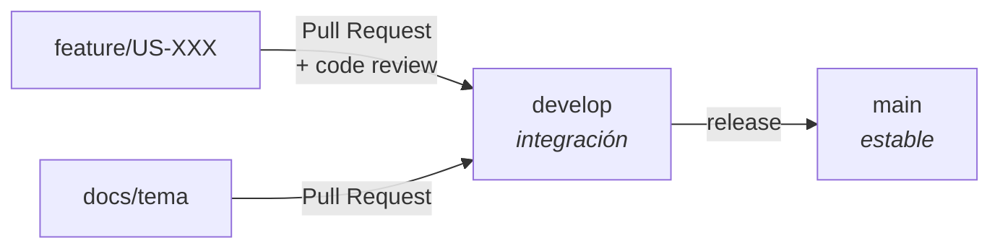

# Plan de Aseguramiento de Calidad (QAP) Ágil

### Anexo 6 — Plataforma Nacional para la Gestión Integral de Becas

|                 |                                                              |
| --------------- | ------------------------------------------------------------ |
| **Proyecto**    | Plataforma Nacional para la Gestión Integral de Becas        |
| **Responsable** | **Todo el equipo Scrum** · coordina Fernando Herrera         |
| **Versión**     | 1.0                                                          |
| **Fecha**       | 12 de septiembre de 2026                                     |

> **La calidad se construye, no se añade al final.** Este plan describe cómo se previene, no cómo
> se inspecciona al cierre. Si al final del proyecto hay que "arreglar la calidad", este documento
> habrá fracasado.

> **Relación con el Plan de Pruebas.** Este QAP define el **proceso**: qué se revisa, quién, cuándo
> y con qué estándar. El Plan de Pruebas (`19-plan-pruebas.md`, Anexo 7) define la **estrategia de
> verificación**: niveles, tipos, cobertura y registro de defectos. Se leen juntos y no se repiten.

---

## 1. Propósito y alcance

**Propósito.** Definir las actividades, estándares y responsabilidades que el equipo adopta para
que cada incremento sea de alta calidad y cumpla las expectativas del Product Owner. El enfoque es
**preventivo y continuo**, no una fase final de pruebas.

**Alcance.** Todos los artefactos y procesos del proyecto, desde que se escribe una historia hasta
que se entrega el software. Cubre el ciclo de vida completo de cada sprint.

## 2. Productos sobre los que se aplica

| Categoría          | Producto                                       | Criterio de calidad                                                       |
| ------------------ | ---------------------------------------------- | ------------------------------------------------------------------------- |
| **Documentación**  | Visión y Product Backlog                       | Claridad, consistencia, completitud                                       |
|                    | Historias y criterios de aceptación            | **INVEST** y testeables. Un criterio que no se puede probar no es criterio |
|                    | Documento de Diseño y Arquitectura             | Coherente con el código real, no con la intención                          |
|                    | Diagramas UML                                  | **Verificados contra el código**, no solo dibujados                        |
| **Código fuente**  | Código de la aplicación                        | Limpio, mantenible, SOLID, con la guía de estilo aplicada                  |
|                    | Scripts de base de datos                       | Versionados como migraciones, nunca cambios manuales                       |
|                    | Código de pruebas                              | Sujeto al mismo estándar que el de producción                              |
| **Incremento**     | Software funcional                             | Cumple la Definition of Done completa                                      |

> **Por qué "verificados contra el código" está en negrita.** En el Sprint 1 el diagrama de clases
> declaraba un método `estaVigente(Date)` que nunca existió: la idea se había separado en dos
> consultas distintas y el diagrama no lo reflejaba. Un diagrama desalineado es peor que no tener
> diagrama, porque se le cree. Desde entonces la verificación contra el código es parte del
> criterio, y cada diagrama lleva una tabla de estado de implementación.

## 3. Normas y prácticas aplicables

| Norma                            | Definición concreta                                                                                        |
| -------------------------------- | ---------------------------------------------------------------------------------------------------------- |
| **Guía de estilo**               | ESLint con `typescript-eslint` + Prettier (`printWidth: 100`, comillas simples). **No se discute de estilo en los code reviews: lo decide el linter** |
| **Nombres de ramas**             | `feature/US-XXX-descripcion-corta`, `docs/tema`, `fix/tema`                                                 |
| **Mensajes de commit**           | Conventional Commits: `tipo(alcance): descripción`. El cuerpo explica **por qué**, no qué                    |
| **Idioma del código**            | Dominio y negocio **en español**, porque el dominio es guatemalteco y el Product Owner lee español. Términos técnicos en inglés |
| **Documentación en el código**   | Cada archivo de capa explica **qué va aquí, qué no va aquí y por qué**. Los comentarios registran decisiones y alternativas descartadas, no lo que el código ya dice |
| **Definition of Done**           | Los **9 puntos** de `04-product-backlog.md` §6. Es el estándar de calidad principal y no admite excepciones |

## 4. Acciones y tareas de calidad

### 4.1 Revisiones técnicas (peer reviews)

**Code review: obligatorio.** Todo código nuevo lo revisa y aprueba al menos otro integrante antes
de integrarse, mediante Pull Request.

| Regla                                                                        | Por qué existe                                                                 |
| ---------------------------------------------------------------------------- | ------------------------------------------------------------------------------ |
| El revisor **se asigna en el Sprint Planning**, no cuando el PR ya está abierto | Acción de mejora de la Retrospectiva 1. Asignar al final es cómo se queda sin revisor |
| El revisor es de la **pareja de turnos contraria** al autor                    | Con las parejas fijas, si no se fuerza, media del equipo nunca ve el trabajo de la otra |
| **Mínimo tres comentarios anclados a línea** por PR                            | Un PR aprobado en treinta segundos sin un comentario se nota, y el enunciado evalúa el code review |
| Se comenta el **trabajo**, nunca la persona                                   | Anexo 3, respeto mutuo                                                          |
| Nada de comentarios de estilo                                                 | Eso lo resuelve el linter. El review es para diseño, casos límite y pruebas que faltan |

**Revisión de documentación.** Los documentos clave los revisa el equipo mediante PR, igual que el
código. Un documento sin revisar es el borrador de una sola persona.

**Uso de asistentes de IA.** Permitido según `02-politica-equipo.md` §3, con dos condiciones
innegociables: **quien lo use debe entender y poder explicar todo lo que integre**, y todo pasa por
el mismo code review. Nadie sube código que no sabría defender ante el catedrático.

### 4.2 Pruebas

Definidas en detalle en el **Anexo 7** (`19-plan-pruebas.md`). El resumen del proceso:

| Nivel                | Responsable              | Requisito del DoD |
| -------------------- | ------------------------ | ----------------- |
| Unitarias            | Quien escribe el código  | Sí                |
| Integración          | Quien escribe el código  | Sí                |
| Aceptación (UAT)     | Product Owner en Staging | Sí, punto 8       |

### 4.3 Integración continua

Cada Pull Request dispara GitHub Actions con PostgreSQL real: **lint, pruebas y build**. Un PR con
el CI en rojo no se mergea.

> **El CI es la única parte del proceso que no depende de que alguien se acuerde**, y por eso es la
> más valiosa. La conclusión práctica: cuando una regla de calidad se pueda automatizar, se
> automatiza, en vez de escribirla en un documento y confiar en la disciplina.

### 4.4 Auditorías de proceso

**La Sprint Retrospective es la herramienta principal de auditoría.** En cada una se responden, con
datos medidos y no de memoria:

- [ ] ¿Todas las historias marcadas como completadas cumplían realmente el DoD?
- [ ] ¿Todos los PR tuvieron code review con comentarios sustantivos?
- [ ] ¿Alguien hizo push directo a `develop` o `main`?
- [ ] ¿Se escribieron pruebas para todo el código nuevo?
- [ ] Cobertura al cierre del sprint: \_\_\_ %
- [ ] Defectos detectados en el sprint: \_\_\_
- [ ] ¿Se cumplió la acción de mejora del sprint anterior?

**Una sola acción de mejora por retrospectiva**, con responsable y con una forma objetiva de
verificarla. Una acción que se cumple vale más que cinco que se olvidan.

## 5. Herramientas

| Función                   | Herramienta                                  |
| ------------------------- | -------------------------------------------- |
| Gestión del proyecto      | GitHub Projects (tablero con el backlog)     |
| Control de versiones      | Git · GitHub (repositorio privado)           |
| Pruebas                   | Jest + ts-jest · supertest para HTTP         |
| Análisis estático         | ESLint + `typescript-eslint`                 |
| Formato                   | Prettier                                     |
| Integración continua      | GitHub Actions                               |
| Base de datos local       | Docker Compose (PostgreSQL 16 + Adminer)     |
| Migraciones               | Prisma Migrate (versionadas en el repositorio) |
| Staging                   | Render (definido como código en `render.yaml`) |

## 6. Administración de la configuración

**Control de versiones.** Todo —código, scripts y documentación técnica— vive en el repositorio
Git. La rama `main` representa siempre una versión estable y potencialmente desplegable.

**Estrategia de ramas** (GitFlow simplificado):

| Rama         | Para qué                        | Quién puede escribir                |
| ------------ | ------------------------------- | ----------------------------------- |
| `main`       | Versiones estables              | Nadie directamente. Solo vía PR     |
| `develop`    | Integración                     | Nadie directamente. Solo vía PR     |
| `feature/*`  | Una historia cada una           | Su autor                            |
| `docs/*`     | Documentación                   | Su autor                            |

> ⚠️ **Hueco conocido en este control.** La prohibición de escribir directo en `main` y `develop`
> es **un acuerdo, no una restricción técnica**: sin GitHub Pro no se pueden activar las reglas de
> protección de rama. Mientras eso siga así, el control depende de que los cuatro se acuerden.
>
> Es un riesgo real y ya se materializó: en el Sprint 1 tres de cinco PRs se mergearon sin
> aprobación. **Activar la protección de rama en cuanto entre GitHub Pro es la mitigación
> estructural**, y está registrada como tal en la Retrospectiva 1.

**Gestión de entornos.** Local para desarrollo, CI para regresión, Staging para la aceptación del
Product Owner. Detalle en `17-staging.md`.

## 7. Registros y su mantenimiento

| Registro                     | Dónde vive                                       | Quién lo mantiene |
| ---------------------------- | ------------------------------------------------ | ----------------- |
| Defectos                     | Issues del repositorio, etiqueta `bug`           | Fernando          |
| Resultado de code reviews    | En los propios Pull Requests                     | Automático        |
| Decisiones de arquitectura   | `05-arquitectura.md` y los mensajes de commit    | Ivan              |
| Justificación de patrones    | `06-patrones.md`                                 | Stuard            |
| Trazabilidad requisito→prueba | `15-matriz-trazabilidad.md`                     | Isaac             |
| Minutas de ceremonias        | `docs/minutas/`                                  | Isaac             |
| Acciones de mejora           | Minuta de cada retrospectiva, revisadas en la siguiente | Isaac      |

> **Los defectos se registran como issues y no en un documento aparte** porque un documento de
> defectos se desactualiza el día que alguien no lo abre. Un issue tiene autor, fecha, estado e
> historial sin que nadie los mantenga a mano.

## 8. Roles y responsabilidades

La calidad es responsabilidad compartida. Lo que cambia es de qué responde cada uno.

| Rol                                    | Responsabilidad de calidad                                                                                   |
| -------------------------------------- | ------------------------------------------------------------------------------------------------------------ |
| **Product Owner** · Ing. Mario Fuentes | Criterios de aceptación claros y valiosos · pruebas de aceptación · priorizar la corrección de defectos        |
| **Proxy PO** · Stuard Estrada          | Verificar los criterios **ya escritos**, sin cambiar alcance · registrar la aceptación moviendo la tarjeta     |
| **Scrum Master** · Isaac Castillo      | Que el proceso de este plan se cumpla · facilitar las retrospectivas · **retirar impedimentos**                |
| **Coordinador de calidad** · Fernando  | Mantener este plan y el Anexo 7 · vigilar la calidad de las pruebas ajenas · llevar el registro de defectos     |
| **Arquitectura y DevOps** · Ivan       | Que el CI y Staging sean confiables · coherencia entre la arquitectura documentada y la real                   |
| **Equipo de desarrollo** · los cuatro  | Código limpio · **escribir las pruebas de lo que producen** · revisar el trabajo ajeno de forma constructiva    |

## 9. Métricas de calidad que se siguen

Pocas y medibles. Una métrica que nadie mide no es una métrica.

| Métrica                              | Meta                    | Al 12 Sep 2026        | Dónde se mide                     |
| ------------------------------------ | ----------------------- | --------------------- | --------------------------------- |
| Pruebas automatizadas                | Creciente cada sprint   | **107** (75 + 32)     | Salida del CI                     |
| Cobertura de sentencias              | ≥ 60 % al 21 Oct        | **41.89 %** ⚠️ mal medida | `npm run test:cov`            |
| PRs con aprobación de otro integrante | 100 %                  | **40 %** (2 de 5)     | Historial de Pull Requests        |
| Advertencias del linter              | 0                       | **0**                 | Salida del CI                     |
| Defectos abiertos de severidad Alta   | 0 al cerrar el sprint  | **1** (US-008)        | Issues con etiqueta `bug`         |
| Patrones implementados y probados     | 6 al 31 Oct            | **1** (Adapter, sin pruebas) | `06-patrones.md`           |

> **Las tres métricas en rojo son las que importan**, y se dicen antes de que nadie las descubra:
> el 40 % de PRs revisados, la cobertura mal medida, y el único patrón implementado sin pruebas.
> Las tres tienen una acción asignada en la Retrospectiva 1 o en el Sprint Backlog 2. Reportar una
> métrica sin acción asociada es decorar.

## 10. Qué hacemos cuando la calidad falla

Un plan de calidad sin procedimiento de fallo es una lista de deseos.

| Situación                                                   | Qué se hace                                                                                       |
| ----------------------------------------------------------- | ------------------------------------------------------------------------------------------------- |
| El CI se pone rojo en `develop`                             | Se arregla **antes** de cualquier trabajo nuevo. Nadie abre un PR sobre una rama roja              |
| Un PR se mergeó sin revisión                                 | Se registra en la retrospectiva con su causa. No se borra ni se disimula                           |
| Una historia se marcó *Done* sin cumplir el DoD              | El Proxy PO la devuelve y queda anotada. Pasó en el Sprint 1 con US-002                            |
| Un criterio de aceptación resulta imposible o ambiguo        | **Se escala al Product Owner.** Ni el Proxy PO ni el equipo cambian alcance por su cuenta          |
| Un defecto crítico aparece a mitad de sprint                 | Interrumpe el sprint. Los críticos no esperan al siguiente Planning                                |
| Alguien incumple repetidamente los compromisos de calidad    | Vía progresiva del Anexo 3 §5 y §6: conversación directa → mediación → arbitraje del equipo → docente |
