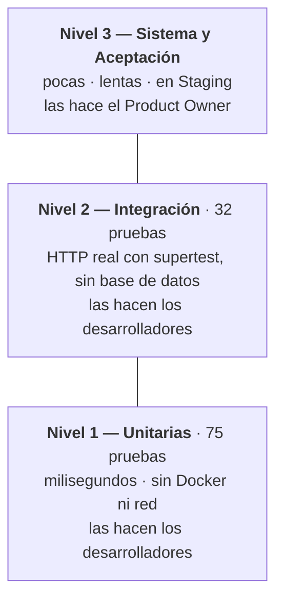

# Plan de Pruebas Ágil

### Anexo 7 — Plataforma Nacional para la Gestión Integral de Becas

|                      |                                                                |
| -------------------- | -------------------------------------------------------------- |
| **Proyecto**         | Plataforma Nacional para la Gestión Integral de Becas          |
| **Responsable**      | Fernando Herrera (calidad y pruebas) · revisado por el equipo  |
| **Versión**          | 1.0                                                            |
| **Fecha**            | 12 de septiembre de 2026                                       |
| **Estado de la suite al escribirlo** | 75 pruebas unitarias + 32 de integración, todas en verde |

> Este plan es una **guía de alto nivel**. El plan de prueba detallado de cada historia son sus
> **criterios de aceptación**, escritos en `04-product-backlog.md`. Aquí se define la estrategia;
> allí se define qué significa que cada cosa funcione.

---

## 1. Propósito

Describir cómo el equipo verifica y valida el producto. La verificación responde *"¿está bien
construido?"* y la validación *"¿es lo que se pidió?"*. Son dos preguntas distintas y este
documento cubre las dos, porque un sistema puede estar impecablemente construido y no servir.

El plan existe además por una razón concreta del curso: el enunciado evalúa **pruebas** como
criterio propio, separado de que el sistema funcione.

## 2. Objetivos

1. **Detectar defectos lo antes posible** (*shift-left*): una prueba unitaria que falla en el
   portátil cuesta minutos; el mismo defecto encontrado por el Product Owner en la Sprint Review
   cuesta una historia entera y credibilidad.
2. **Verificar que cada historia cumple sus criterios de aceptación**, palabra por palabra y no
   por aproximación.
3. **Impedir regresiones**: que lo nuevo no rompa lo que ya funcionaba.
4. **Producir evidencia**, no opiniones. "Lo probé y anda" no es un resultado de prueba.

> ### Lección del Sprint 1 que este plan incorpora
>
> Tres de los diez defectos del Sprint 1 fueron **pruebas que pasaban sin probar lo que decían**.
> La más clara: una prueba llamada "ordena las convocatorias por fecha de cierre" pasaba en verde
> aunque el servicio no ordenara nada, porque el doble de prueba ya venía ordenado. Verificaba el
> doble, no el código.
>
> De ahí sale la regla §5.4 de este plan: **una prueba solo vale si se puede razonar qué la pondría
> roja.** Si no se sabe, no está probando; está acompañando.

## 3. Alcance

### 3.1 En alcance

Todas las funcionalidades del Product Backlog. Por sprint, el alcance son las historias
seleccionadas en el Planning. Hoy cubre:

| Módulo         | Qué se prueba                                                            |
| -------------- | ------------------------------------------------------------------------ |
| `usuarios`     | Autenticación, roles, control de acceso, entidad y objetos de valor      |
| `convocatorias`| Listado público, reglas de visibilidad, período de postulación, mapeo    |
| `salud`        | *Liveness* (`/health`) y *readiness* (`/ready`)                          |

### 3.2 Fuera de alcance

Se declara explícitamente para que nadie lo dé por hecho:

| Fuera de alcance                                    | Por qué                                                                        |
| --------------------------------------------------- | ------------------------------------------------------------------------------ |
| Pruebas de carga y estrés con >100 usuarios         | El NFR de rendimiento se verifica con una medición puntual, no con una campaña   |
| Navegadores obsoletos (Internet Explorer)            | El NFR de compatibilidad cubre las últimas versiones de Chrome, Firefox y Edge  |
| Infraestructura de red y hardware                    | Es responsabilidad del proveedor de Staging                                     |
| Pruebas de penetración                               | Fuera del alcance del curso. Sí se prueban los controles de acceso que sí están |
| Accesibilidad (WCAG)                                 | No está en los NFRs. **Se anota como deuda**: un portal del Estado debería tenerla |

## 4. Entorno y Configuración

| Entorno                    | Propósito                                       | Configuración                                                                    |
| -------------------------- | ----------------------------------------------- | -------------------------------------------------------------------------------- |
| **Local**                  | Unitarias e integración durante el desarrollo   | Node 22 · PostgreSQL 16 en Docker Compose · Jest + ts-jest · supertest           |
| **CI (GitHub Actions)**    | Regresión automática en cada Pull Request        | Ubuntu · PostgreSQL 16 como servicio · corre lint, pruebas y build                |
| **Staging**                | Aceptación del Product Owner                     | Render · PostgreSQL administrado · ver `17-staging.md`                            |

**Navegadores soportados:** últimas versiones de Chrome, Firefox y Edge.

> ⚠️ **Staging todavía no existe** al escribir este documento. Mientras siga así, el nivel 3
> (§5.1) **no se puede ejecutar**, y por lo tanto ninguna historia puede cumplir la Definition of
> Done. Es el impedimento principal del proyecto, no un detalle pendiente.

## 5. Estrategia de Pruebas

Pirámide de pruebas: muchas rápidas y baratas abajo, pocas lentas y caras arriba.



### 5.1 Niveles

| Nivel                        | Quién                     | Cuándo                                    | Qué prueba                                                        | Herramienta        |
| ---------------------------- | ------------------------- | ----------------------------------------- | ----------------------------------------------------------------- | ------------------ |
| **1 · Unitarias**            | Quien escribe el código   | Continuamente. Es requisito del DoD       | Entidades, objetos de valor y casos de uso, aislados              | Jest + ts-jest     |
| **2 · Integración**          | Quien escribe el código   | Al terminar la historia                   | La ruta HTTP completa: validación, guards, controlador, servicio  | Jest + supertest   |
| **3 · Sistema y Aceptación** | Todo el equipo, y el PO   | Cuando la historia está lista, en Staging | Flujos de punta a punta y criterios de aceptación                 | Manual y explorat. |

**Por qué el nivel 1 corre sin base de datos:** el dominio no conoce Prisma. Cada puerto tiene dos
adaptadores —uno real y uno en memoria— y las pruebas inyectan el segundo. No es una comodidad: es
la demostración práctica de que la inversión de dependencias funciona, y el argumento de
testeabilidad de `05-arquitectura.md` §2.2 comprobado en vez de afirmado.

### 5.2 Tipos de prueba adicionales

| Tipo                        | Cuándo                              | Cómo                                                                        |
| --------------------------- | ----------------------------------- | --------------------------------------------------------------------------- |
| **Regresión**               | En cada Pull Request, automática    | El CI corre la suite completa. Un PR con la suite roja no se mergea          |
| **Exploratorias**           | Antes de cada Sprint Review         | El equipo "juega" con la aplicación buscando fallos que nadie previó         |
| **De contrato entre enums** | Automática                          | Una prueba compara los roles del dominio con los de Prisma y falla si divergen |
| **Negativas**               | Siempre, junto a la del camino feliz| Toda regla tiene una prueba de que **rechaza** lo que debe rechazar          |

> **Las pruebas negativas no son opcionales en este proyecto.** El criterio de US-003 no dice
> "el administrador entra": dice *"un acceso no autorizado devuelve 403, no 404 ni el recurso"*.
> Eso solo se puede probar intentando entrar sin permiso. De las 32 pruebas de integración
> actuales, la mayoría son negativas.

### 5.3 Criterios de entrada y salida

**Entrada** — una historia está lista para el nivel 3 cuando:

- [ ] El código está completo y en un Pull Request
- [ ] Las pruebas unitarias y de integración de esa historia están en verde
- [ ] El code review está aprobado por alguien distinto del autor
- [ ] El linter pasa sin advertencias

**Salida** — las pruebas de una historia terminan cuando cumple **los 9 puntos de la Definition of
Done**, incluida la verificación del Proxy Product Owner. No hay salida parcial: una historia con
8 de 9 puntos no está probada, está en progreso.

### 5.4 Reglas de calidad de las propias pruebas

Nacen de defectos reales encontrados en el Sprint 1, no de teoría:

1. **Toda prueba debe tener una forma conocida de ponerse roja.** Si no se puede explicar qué
   cambio la rompería, no está probando nada. _(Defecto 5: la prueba de ordenamiento verificaba el
   doble de prueba.)_
2. **Si el código registra algo importante en el log, hay que comprobar el log.** El aviso *es* la
   funcionalidad cuando es lo único que delataría un fallo en producción. _(Defecto 6.)_
3. **Un doble de prueba no debe ser más listo que el código real.** Si el doble ordena, filtra o
   corrige por su cuenta, oculta la ausencia de esa lógica en el código. _(Defecto 5, otra vez.)_
4. **El código que se va a presentar como evidencia tiene que estar probado.** Los tres adaptadores
   del patrón Adapter están hoy a 0 % porque las pruebas los sustituyen por dobles: bcrypt y JWT
   reales nunca se ejecutan. _(Defecto pendiente DEF-02.)_
5. **Los criterios de aceptación se prueban textualmente.** Si el criterio dice "mensaje genérico
   que no revele cuál de los dos campos falló", la prueba compara los dos mensajes. No se
   parafrasea un criterio para que sea más fácil de probar.

## 6. Cobertura de código

**Meta:** ≥ 60 % de sentencias para el **21 de octubre de 2026** (WBS 7.3).

**Medición al 12 de septiembre de 2026:** 41.89 % de sentencias · 43.42 % de ramas.

> ### ⚠️ Ese número está mal medido, y por debajo de la realidad
>
> `npm run test:cov` ejecuta **solo las pruebas unitarias**. La configuración de Jest para
> unitarias tiene `rootDir: "src"` y solo reconoce `*.spec.ts`; la de integración
> (`test/jest-e2e.json`) usa otro `rootDir`, otro patrón, y **no declara cobertura en absoluto**.
>
> Consecuencia: las 32 pruebas de integración —que son justamente las que ejercitan controladores,
> guards y validación— **no cuentan en el porcentaje**. Controladores que sí están probados de
> punta a punta aparecen a 0 %.
>
> **Corregir la medición es requisito previo a perseguir la meta** (defecto DEF-03, comprometido
> en el Sprint 2). Perseguir un 60 % contra un número que no sabemos leer llevaría a escribir
> pruebas donde no hacen falta.

**Qué se exige cubrir, por prioridad.** La cobertura es un indicador, no un objetivo: un 100 % con
pruebas que no pueden fallar no vale nada.

| Prioridad | Qué                                                     | Por qué                                                     |
| --------- | ------------------------------------------------------- | ----------------------------------------------------------- |
| **1**     | Entidades, objetos de valor y casos de uso              | Es donde viven las reglas de negocio                        |
| **2**     | Guards y control de acceso                              | Un fallo aquí es una fuga de datos, no una molestia          |
| **3**     | Adaptadores con bibliotecas reales (bcrypt, JWT)         | Hoy a 0 %, y son la evidencia del patrón Adapter             |
| **4**     | Controladores y DTO                                      | Cubiertos por integración, no por unitarias                  |
| _No se exige_ | Módulos de NestJS y `main.ts`                      | Son configuración. Ya están excluidos de la medición          |

## 7. Registro de defectos

Los defectos se registran como **issues del repositorio** con la etiqueta `bug`, y entran al
Product Backlog priorizados por el Product Owner como cualquier otra historia.

**Cada reporte debe incluir:**

| Campo                            | Obligatorio |
| -------------------------------- | ----------- |
| Título descriptivo               | Sí          |
| Pasos para reproducirlo          | Sí          |
| Resultado esperado vs. obtenido  | Sí          |
| Severidad                        | Sí          |
| Capturas o vídeo                 | Si aplica   |

**Escala de severidad**, con el criterio de atención acordado:

| Severidad     | Definición                                                      | Cuándo se atiende                        |
| ------------- | --------------------------------------------------------------- | ---------------------------------------- |
| **Crítico**   | Pérdida de datos, fuga de información, o el sistema no arranca   | Inmediato, interrumpe el sprint          |
| **Alto**      | Una funcionalidad principal no sirve y no hay forma de rodearla   | En el sprint en curso                    |
| **Medio**     | Falla con alternativa, o un criterio de aceptación incumplido     | Se prioriza en el siguiente Planning     |
| **Bajo**      | Cosmético, o molestia menor                                      | Cuando haya holgura                      |

### 7.1 Defectos abiertos al 12 de septiembre de 2026

| ID       | Defecto                                                                | Severidad | Estado                     |
| -------- | ---------------------------------------------------------------------- | --------- | -------------------------- |
| DEF-01   | `ConvocatoriaPrismaRepositorio` sin cobertura de pruebas (issue #6)     | Medio     | Abierto                    |
| DEF-02   | Los tres adaptadores del patrón Adapter a 0 % de cobertura              | Medio     | Comprometido en Sprint 2   |
| DEF-03   | La medición de cobertura excluye las pruebas de integración              | Medio     | Comprometido en Sprint 2   |
| US-008   | El listado público quedó detrás del login: criterio incumplido           | **Alto**  | Diferido al Sprint 3 con decisión escrita |
| US-002   | Falta el bloqueo tras 5 intentos fallidos: criterio incumplido           | Medio     | Diferido al Sprint 3       |

> Los dos últimos son **criterios de aceptación incumplidos**, no errores de programación. Se
> registran igual: para el Product Owner la diferencia es irrelevante, porque en ambos casos el
> sistema no hace lo que se acordó.

## 8. Resultados esperados (entregables)

Las pruebas no producen un documento final, sino artefactos continuos:

| Entregable                        | Dónde vive                                                          |
| --------------------------------- | ------------------------------------------------------------------- |
| Suite automatizada                | Junto al código, en el repositorio: `*.spec.ts` y `*.e2e-spec.ts`   |
| Reportes de ejecución             | Salida del CI en cada Pull Request, con historial                    |
| Reporte de cobertura              | `coverage/` — generado por `npm run test:cov`                        |
| Registro de defectos              | Issues del repositorio con etiqueta `bug`                            |
| Evidencia de verificación en Staging | Resumen del workflow *Verificar Staging* (ver `17-staging.md` §3)  |
| Aceptación del Product Owner      | Tarjeta movida a *Done* por el Proxy PO + registro en la minuta de Review |

## 9. Cómo se ejecuta

```bash
npm run test        # 75 pruebas unitarias, sin Docker
npm run test:e2e    # 32 pruebas de integración
npm run test:cov    # cobertura (ver la advertencia de §6)
npm run lint        # ESLint + Prettier
```

Para las de integración y el desarrollo local hace falta PostgreSQL levantado:
`docker compose up -d`. Los pasos completos están en `13-guia-instalacion.md`.

## 10. Roles y responsabilidades

La calidad no es de una persona. Este plan la reparte así:

| Rol                             | Responsabilidad en pruebas                                                          |
| ------------------------------- | ----------------------------------------------------------------------------------- |
| **Product Owner** (Ing. Fuentes) | Definir criterios de aceptación claros y testeables. Ejecutar la aceptación en Staging |
| **Proxy PO** (Stuard)            | Verificar los criterios ya escritos, sin cambiar alcance, y registrar la aceptación  |
| **Responsable de calidad** (Fernando) | Mantener este plan, revisar la calidad de las pruebas ajenas y llevar el registro de defectos |
| **Desarrolladores** (los cuatro) | Escribir las pruebas del código que producen. **No es delegable** |
| **DevOps** (Ivan)                | Que el CI y Staging funcionen y sean confiables                                       |
| **Scrum Master** (Isaac)         | Que el DoD se cumpla sin excepciones y retirar los impedimentos que lo bloqueen       |
