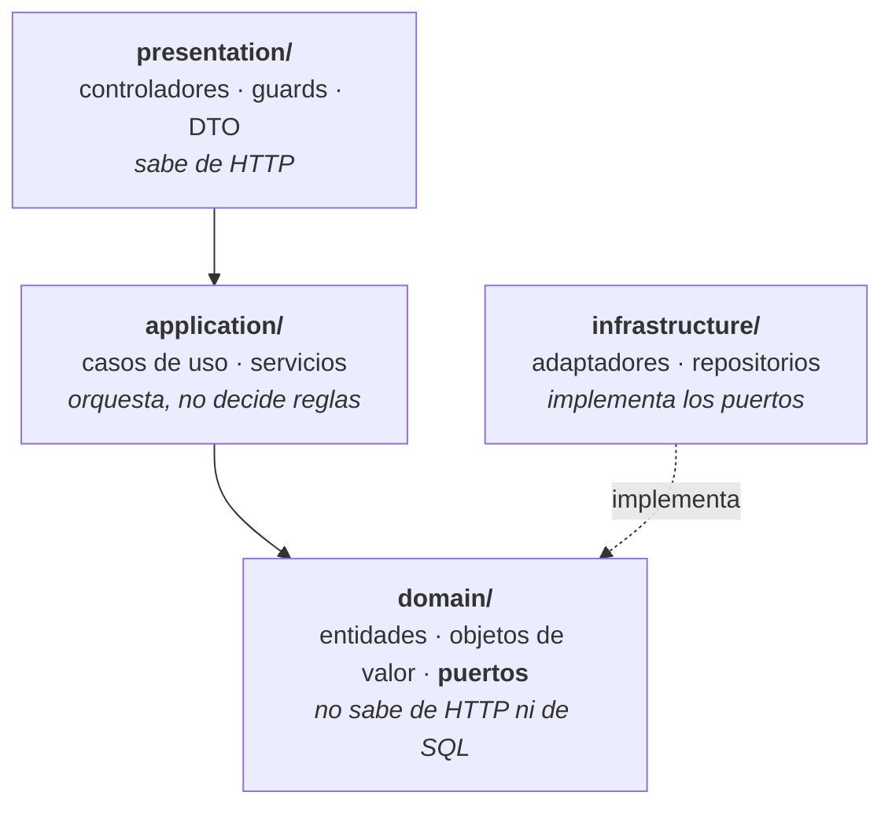

# Manual Técnico

### Plataforma Nacional para la Gestión Integral de Becas

|                        |                                                    |
| ---------------------- | -------------------------------------------------- |
| **Versión del sistema** | 0.1.0                                             |
| **Versión del manual** | 1.0                                                |
| **Fecha**              | 12 de septiembre de 2026                           |
| **Responsable**        | Ivan Castellan (arquitectura) · Isaac Castillo     |
| **Dirigido a**         | Quien tenga que mantener, extender o desplegar este sistema |

> **Qué es y qué no es este documento.** Es el manual para **desarrolladores**: cómo está
> construido el sistema, por qué, y cómo trabajar en él. El manual para quien lo usa es
> `21-manual-usuario.md`.
>
> Describe el estado real al 12 de septiembre de 2026. Lo que no está implementado se marca como
> tal; **no se documenta nada como existente si no existe**.

---

## 1. Qué hace el sistema

Administra el ciclo de vida completo de las becas del Ministerio de Educación de Guatemala:
convocatorias, registro de estudiantes, solicitudes, documentación, comités evaluadores,
resolución y consulta pública.

**Implementado hoy:** inicio de sesión, control de acceso por rol, listado público de
convocatorias y diagnósticos de salud. El resto está en el Product Backlog con su sprint asignado.

## 2. Stack técnico y por qué

| Capa                | Tecnología              | Por qué esta                                                                                    |
| ------------------- | ----------------------- | ----------------------------------------------------------------------------------------------- |
| Lenguaje            | TypeScript 5.7          | Un solo lenguaje en backend y frontend, y tipos que permiten refactorizar sin miedo             |
| Backend             | NestJS 11               | Trae inyección de dependencias de serie, que es lo que hace posible la arquitectura por capas   |
| Frontend            | React 19 + Vite         | Vite arranca en milisegundos; el equipo ya conocía React                                        |
| Base de datos       | PostgreSQL 16           | Relacional, porque el dominio lo es: una solicitud pertenece a una convocatoria y a un estudiante |
| ORM                 | Prisma 6                | Migraciones versionadas en el repositorio y tipos generados del esquema                          |
| Pruebas             | Jest 29 + supertest 7   | Estándar del ecosistema, y supertest permite probar HTTP sin levantar un servidor aparte        |
| Entorno local       | Docker Compose          | Los cuatro integrantes trabajan contra una base idéntica                                        |
| CI                  | GitHub Actions          | Integrado al repositorio, sin infraestructura que mantener                                      |
| Runtime             | Node 22                 | Versión LTS                                                                                     |

> La justificación completa está en `05-arquitectura.md`. Aquí va el resumen operativo.

## 3. Arquitectura

**Monolito modular en capas, con inversión de dependencias.** No microservicios: el catedrático
los prohíbe expresamente, y para un equipo de cuatro personas serían sobreingeniería.

### 3.1 Las cuatro capas



**La regla que sostiene todo:** las flechas apuntan **hacia dentro**. `domain/` no importa nada de
las otras capas. `infrastructure/` no es una capa "de abajo" de la que dependa el dominio: es una
capa externa que **implementa interfaces que el dominio declara**.

Consecuencia práctica y verificable: las 75 pruebas unitarias corren **sin Docker, sin PostgreSQL y
sin red**, porque inyectan repositorios en memoria. Eso no es una comodidad de las pruebas; es la
demostración de que la inversión de dependencias funciona.

### 3.2 Estructura de carpetas

```
proyecto-becas/
├── apps/
│   ├── api/                         Backend NestJS
│   │   ├── prisma/
│   │   │   ├── schema.prisma        Esquema de la base de datos
│   │   │   ├── migrations/          Migraciones versionadas
│   │   │   └── seed.ts              Datos iniciales (SOLO desarrollo)
│   │   ├── src/
│   │   │   ├── modules/
│   │   │   │   ├── usuarios/        Autenticación y control de acceso
│   │   │   │   ├── convocatorias/   Programas de beca
│   │   │   │   ├── estudiantes/     Perfil académico (US-011)
│   │   │   │   ├── solicitudes/     Solicitudes, documentos e historial (EPIC-03)
│   │   │   │   ├── evaluaciones/    Comités, asignación, dictámenes y consolidado (EPIC-04)
│   │   │   │   ├── resoluciones/    Resolución, adjudicación y consulta pública (EPIC-05)
│   │   │   │   ├── reportes/        Reportes, panel y exportación (EPIC-06; solo lee)
│   │   │   │   └── salud/           /health y /ready
│   │   │   ├── shared/
│   │   │   │   ├── exceptions/      Filtro global de errores de dominio
│   │   │   │   └── persistence/     PrismaService
│   │   │   └── main.ts              Arranque: CORS, validación, filtros
│   │   └── test/                    Pruebas de integración (*.e2e-spec.ts)
│   └── web/                         Frontend React
│       └── src/
│           ├── api/                 Cliente HTTP
│           ├── componentes/
│           ├── paginas/
│           └── sesion/              Contexto de sesión y ruta protegida
├── docs/                            Toda la documentación del proyecto
├── docker-compose.yml               PostgreSQL + Adminer para desarrollo
└── render.yaml                      Definición del entorno de Staging
```

**Cada módulo repite las cuatro capas por dentro.** Un módulo nuevo se crea copiando esa estructura,
no inventando otra.

### 3.3 Los puertos y sus adaptadores

Es la evidencia del patrón **Adapter** y la tabla que demuestra la inversión de dependencias:

| Puerto (lo que el dominio necesita)      | Adaptadores (lo que la infraestructura ofrece)                  | Qué aísla                  |
| ---------------------------------------- | --------------------------------------------------------------- | -------------------------- |
| `usuarios/domain/ports/hasher-password`  | `BcryptHasherAdapter`                                           | La biblioteca de hashing   |
| `usuarios/domain/ports/generador-token`  | `JwtGeneradorTokenAdapter`                                      | El formato de sesión       |
| `usuarios/domain/ports/verificador-token`| `JwtVerificadorTokenAdapter`                                    | La validación de sesión    |
| `usuarios/domain/ports/usuario.repositorio` | `UsuarioPrismaRepositorio` · `UsuarioEnMemoriaRepositorio`    | La persistencia            |
| `convocatorias/domain/ports/convocatoria.repositorio` | `ConvocatoriaPrismaRepositorio` · `ConvocatoriaEnMemoriaRepositorio` | La persistencia |
| `estudiantes/domain/ports/estudiante.repositorio` | `EstudiantePrismaRepositorio` · `EstudianteEnMemoriaRepositorio` | La persistencia |
| `solicitudes/domain/ports/solicitud.repositorio` | `SolicitudPrismaRepositorio` · `SolicitudEnMemoriaRepositorio` | La persistencia (solicitud, documentos e historial en una transacción) |
| `solicitudes/domain/ports/almacenamiento-documentos` | `AlmacenamientoLocalAdapter` · `AlmacenamientoMemoriaAdapter` | Dónde se guardan los archivos |
| `solicitudes/domain/ports/notificador-solicitudes` | `NotificadorConsolaAdapter` | El canal de avisos (correo en US-022) |
| `solicitudes/domain/ports/consultas-externas` | `ConsultaConvocatoriasAdapter` · `ConsultaPerfilesAdapter` | Los otros módulos: se les pregunta por su capa de aplicación, nunca por su dominio |
| `evaluaciones/domain/ports/comite.repositorio` · `dictamen.repositorio` | `ComitePrismaRepositorio` · `DictamenPrismaRepositorio` y sus dobles en memoria | La persistencia. El de dictámenes **solo crea y lee** |
| `evaluaciones/domain/ports/consultas-externas` | Cuatro adaptadores hacia `solicitudes`, `convocatorias`, `estudiantes` y `usuarios` | Los otros módulos. Ninguno de ellos depende de `evaluaciones` |
| `resoluciones/domain/ports/consultas-externas` | Cuatro adaptadores hacia `solicitudes`, `evaluaciones`, `convocatorias` y `usuarios` | Los colaboradores de la fachada. `resoluciones` es el módulo más alto: nadie depende de él |
| `resoluciones/domain/ports/notificador-resoluciones` | `NotificadorResolucionesConsolaAdapter` | El aviso de resolución y adjudicación (correo en US-022) |
| `reportes/domain/ports/puertos` (fuentes) | Tres adaptadores hacia `solicitudes`, `estudiantes` y `convocatorias` | De dónde salen los datos. `reportes` no escribe nada |
| `reportes/domain/ports/puertos` (`ExportadorReporte`) | `CsvExportador` · `PdfExportador` | El formato de salida. Uno nuevo es una clase más en la lista `EXPORTADORES` |

El enlace ocurre en un único punto por módulo, el archivo `*.module.ts`:

```ts
{ provide: HASHER_PASSWORD,   useClass: BcryptHasherAdapter },
{ provide: GENERADOR_TOKEN,   useClass: JwtGeneradorTokenAdapter },
{ provide: VERIFICADOR_TOKEN, useClass: JwtVerificadorTokenAdapter },
```

**Cambiar bcrypt por argon2, o JWT por sesiones en servidor, es cambiar una línea de ese archivo.**
Ni la entidad, ni el caso de uso, ni el controlador se enteran.

## 4. API

Base local: `http://localhost:3000`

### 4.1 Rutas implementadas

| Método | Ruta              | Acceso   | Qué hace                                    |
| ------ | ----------------- | -------- | ------------------------------------------- |
| `POST` | `/auth/login`     | Público  | Inicia sesión y devuelve un token           |
| `GET`  | `/convocatorias`  | Público  | Lista las convocatorias publicadas y vigentes |
| `GET`  | `/health`         | Público  | *Liveness*: ¿vive el proceso?               |
| `GET`  | `/ready`          | Público  | *Readiness*: ¿responde PostgreSQL?          |
| `GET`  | `/convocatorias/gestion` | **ADMINISTRADOR** | Todas, incluidos borradores |
| `GET`  | `/convocatorias/catalogo` | **ADMINISTRADOR** | Requisitos, documentos y valores por defecto de cada tipo |
| `POST` | `/convocatorias`  | **ADMINISTRADOR** | Crea una convocatoria en BORRADOR (US-006) |
| `POST` | `/convocatorias/:id/publicar` | **ADMINISTRADOR** | La publica (US-007) |
| `POST` | `/auth/registro`  | Público  | Registra un estudiante y devuelve la sesión iniciada (US-001) |
| `GET` · `PUT` | `/estudiantes/perfil` | **ESTUDIANTE** | Consulta o guarda el propio perfil (US-011) |
| `GET`  | `/estudiantes/departamentos` | **ESTUDIANTE** | Los 22 departamentos, para el formulario |
| `POST` | `/solicitudes` | **ESTUDIANTE** | Crea una solicitud en BORRADOR (US-012) |
| `GET`  | `/solicitudes` | **ESTUDIANTE** | Las propias, con estado, documentos e historial (US-015, US-016) |
| `GET`  | `/solicitudes/:id` | **ESTUDIANTE** | Una propia. La de otra persona responde **403** |
| `PUT`  | `/solicitudes/:id/documentos/:tipo` | **ESTUDIANTE** | Carga o reemplaza un documento; multipart, campo `archivo` (US-013) |
| `GET`  | `/solicitudes/:id/documentos/:tipo` | **ESTUDIANTE** | Descarga el propio documento |
| `POST` | `/solicitudes/:id/enviar` | **ESTUDIANTE** | La envía (US-014) |
| `GET` · `POST` | `/evaluadores` | **ADMINISTRADOR** | Lista o crea cuentas de evaluador (US-017). Mismo cuerpo que el registro |
| `GET` · `POST` | `/comites` | **ADMINISTRADOR** | Lista o crea comités (US-017) |
| `GET` | `/comites/:id` | **ADMINISTRADOR** | Detalle, con carga de cada integrante |
| `POST` | `/comites/:id/evaluadores` | **ADMINISTRADOR** | Agrega integrantes |
| `GET` | `/comites/:id/por-asignar` | **ADMINISTRADOR** | Las solicitudes ENVIADAS de su convocatoria (US-018) |
| `POST` | `/comites/:id/asignaciones` | **ADMINISTRADOR** | `{ "modo": "AUTOMATICO", "porSolicitud": 2 }` o `{ "modo": "MANUAL", "asignaciones": [...] }` (US-018) |
| `GET` | `/comites/:id/consolidado` | **ADMINISTRADOR** | Puntaje promedio y ranking (US-021) |
| `GET` | `/evaluaciones/asignadas` | **EVALUADOR** | Las propias (US-020) |
| `GET` | `/evaluaciones/solicitudes/:id` | **EVALUADOR** | Solicitante, documentos y puntaje calculado. Si no está asignada: **403** |
| `GET` | `/evaluaciones/solicitudes/:id/documentos/:tipo` | **EVALUADOR** | Descarga un documento de una solicitud asignada |
| `POST` | `/evaluaciones/solicitudes/:id/dictamen` | **EVALUADOR** | `{ "recomendacion", "observacion" }`. El puntaje **no se manda**: mandarlo es 400 (US-019) |
| `POST` | `/resoluciones/solicitudes/:id` | **ADMINISTRADOR** | `{ "decision": "APROBAR" \| "RECHAZAR", "motivo" }` (US-023). Sin cupo: 422 |
| `POST` | `/resoluciones/solicitudes/:id/adjudicar` | **ADMINISTRADOR** | Adjudica una APROBADA y crea la beca (US-024) |
| `GET` | `/resoluciones/convocatorias/:id/cupos` | **ADMINISTRADOR** | Cupos totales, aprobadas, adjudicadas y disponibles |
| `GET` | `/reportes/solicitudes` | **ADMINISTRADOR** | US-028. Parámetros opcionales: `convocatoriaId`, `estado` (lista separada por comas), `nivel`, `departamento`, `desde`, `hasta` (AAAA-MM-DD, hora de Guatemala, inclusivas), `agruparPor`, `ordenarPor`, `formato` (`JSON`, `CSV`, `PDF`). Combinaciones sin sentido: 422 |
| `GET` | `/reportes/panel` | **ADMINISTRADOR** | US-029. `convocatoriaId` opcional |
| `GET` | `/reportes/regiones` | **ADMINISTRADOR** | US-031. `convocatoriaId` y `formato` opcionales |
| `POST` | `/consulta-publica` | **Público** | `{ "numero", "cui" }` → solo `numero`, `estado`, `ultimoCambio` (US-025). 404 genérico; 429 tras 10 consultas por minuto |

> **El id del estudiante nunca viaja en la URL ni en el cuerpo.** Sale del token con el decorador
> `@UsuarioActual()`. No existe una forma de pedir "las solicitudes del estudiante X".

> **Las públicas lo son deliberadamente**, no por olvido. El guard de autenticación es **global y
> seguro por defecto**: toda ruta exige sesión salvo que se marque con `@Publico()`. Cada una de
> las cuatro públicas tiene su justificación escrita: el login es donde se *obtiene* la sesión, el
> listado lo exige US-008 para visitantes sin cuenta, y los dos diagnósticos los consume el
> monitoreo.

**Códigos de error de las rutas de gestión**, que salen del filtro de excepciones del dominio:

| Código | Cuándo |
|---|---|
| 400 | Datos con forma inválida: tipo inexistente, requisito fuera del catálogo, id que no es UUID, o un campo no permitido como `estado` |
| 404 | La convocatoria no existe |
| 409 | Transición inválida: publicar algo que no está en BORRADOR |
| 403 | Recurso ajeno: la solicitud de otro estudiante (`AccesoDenegadoError`, US-003) |
| 413 | Archivo de más de 5 MB (lo corta la recepción antes de leerlo entero) |
| 422 | Regla de negocio: cierre anterior a la apertura, posgrado con más de 50 cupos, publicar sin requisitos, perfil incompleto, archivo que no es lo que dice ser, enviar con documentos faltantes |

### 4.2 `POST /auth/login`

**Petición**

```json
{ "nombreUsuario": "admin", "password": "..." }
```

Validación: ambos obligatorios. `nombreUsuario` máximo 30 caracteres; `password` máximo 72,
porque bcrypt solo considera los primeros 72 bytes y aceptar cadenas arbitrarias permitiría
saturar la CPU.

**Respuesta 200**

```json
{
  "token": "eyJhbGciOi...",
  "expiraEn": "2026-09-12T20:00:00.000Z",
  "usuario": {
    "id": "uuid",
    "nombreUsuario": "admin",
    "correo": "admin@becas.gob.gt",
    "rol": "ADMINISTRADOR"
  }
}
```

**Respuesta 401** — mensaje **genérico a propósito**: no revela si falló el usuario o la
contraseña. Distinguirlos le diría a quien tantea si va por buen camino.

**Bloqueo tras intentos fallidos** (criterio 3 de US-002). Tras **5 intentos fallidos
consecutivos** la cuenta queda bloqueada **15 minutos**:

| Comportamiento | Por qué |
|---|---|
| Durante el bloqueo se rechaza **incluso la contraseña correcta** | Si no, el atacante seguiría probando y sabría cuándo acertó |
| Durante el bloqueo **no se verifica la contraseña real**, pero se gasta el mismo tiempo contra un hash señuelo | Una cuenta bloqueada no debe responder más rápido que una activa |
| El mensaje sigue siendo el genérico, **no dice "cuenta bloqueada"** | Decirlo confirmaría a un atacante que el usuario existe. Se prefirió no confirmar |
| El bloqueo **caduca solo** a los 15 minutos | No depende de una tarea programada que, si fallara, dejaría cuentas bloqueadas para siempre |
| Un acceso correcto **reinicia el contador** | El criterio dice intentos *consecutivos* |

La política (5 y 15) son constantes del **dominio**, `MAX_INTENTOS_FALLIDOS` y
`MINUTOS_DE_BLOQUEO` en `usuario.entity.ts`, y no variables de entorno: son un criterio de
aceptación acordado con el Product Owner, no un ajuste operativo.

### 4.3 `GET /convocatorias`

Devuelve un arreglo de convocatorias **publicadas y vigentes**, ordenadas por fecha de cierre más
próxima. El orden es parte del contrato del caso de uso, no una optimización del adaptador.

```json
[
  {
    "id": "uuid",
    "codigo": "UNIV-2026-01",
    "titulo": "Beca Universitaria 2026",
    "descripcion": "...",
    "tipo": "UNIVERSITARIA",
    "estado": "PUBLICADA",
    "cupos": 100,
    "fechaApertura": "2026-09-01T00:00:00.000Z",
    "fechaCierre": "2026-10-31T00:00:00.000Z"
  }
]
```

### 4.4 `GET /health` y `GET /ready` — por qué son dos

| Ruta      | Responde                        | Uso                                            |
| --------- | ------------------------------- | ---------------------------------------------- |
| `/health` | 200 si el proceso está vivo     | Que el orquestador no reinicie un proceso sano  |
| `/ready`  | 200 si PostgreSQL responde, **503 si no** | Que no se le manden peticiones a una instancia que no puede atenderlas |

**Eran una sola ruta y era un defecto.** `/health` respondía `ok` aunque PostgreSQL estuviera
caído, porque se hizo así para que la API arrancara sin Docker. Es decir: no servía para verificar
nada. Fue el defecto 1 de los tres del esqueleto, corregido en S1-12.

### 4.5 Autenticación y autorización

**Autenticación.** Token JWT HS256 con vigencia de 8 horas, que viaja en la cabecera:

```
Authorization: Bearer <token>
```

El nombre del esquema se compara **sin distinguir mayúsculas** (RFC 7235 §2.1): `bearer` y
`BEARER` son válidos. El token **no** se normaliza. Una cabecera con dos credenciales separadas
por coma se rechaza explícitamente, en vez de adivinar cuál vale.

**Autorización.** Dos guards globales, en este orden:

1. `AutenticacionGuard` — verifica el token y adjunta el portador a la petición
2. `RolesGuard` — comprueba que el rol baste para la ruta

```ts
@Publico()                              // abre la ruta a cualquiera
@Roles(RolUsuario.ADMINISTRADOR)        // exige sesión Y ese rol
```

Ambos decoradores funcionan a nivel de **método o de clase**, y gana el más específico. Sin
`@Roles` basta con estar autenticado.

**Códigos de respuesta, que son criterios de aceptación de US-003:**

| Situación                | Código | Por qué                                            |
| ------------------------ | ------ | -------------------------------------------------- |
| Sin token                | 401    | No se sabe quién es                                |
| Token inválido o vencido | 401    | Mismo mensaje que el anterior, a propósito         |
| Rol insuficiente         | **403**| **No 404 ni el recurso.** Criterio textual de US-003 |

**Limitación aceptada conscientemente:** el token es autocontenido y no se consulta la base en
cada petición. El precio es que **desactivar un usuario no invalida su token hasta que caduque**,
como máximo 8 horas después. Si el Ministerio exigiera revocación inmediata haría falta una lista
de revocación, y eso cambia el diseño.

### 4.6 Roles

| Rol             | Persistido | Qué es                                      |
| --------------- | ---------- | ------------------------------------------- |
| `ESTUDIANTE`    | Sí         | Aspirante que postula                       |
| `EVALUADOR`     | Sí         | Integrante de un comité                     |
| `ADMINISTRADOR` | Sí         | Personal de la Dirección de Becas           |
| `PUBLICO`       | **No**     | Visitante sin sesión                        |

`PUBLICO` existe en el enum del dominio pero **no en el de Prisma**, y es deliberado: no hay filas
de `Usuario` con ese rol y no debe poder haberlas. La constante `ROLES_PERSISTIBLES` marca la
diferencia, y una prueba la fija para que nadie la "arregle" agregándolo al esquema.

## 5. Base de datos

Once tablas hoy. El dominio declara sus propios enums en lugar de importar los de Prisma, para no
meter el ORM dentro de `domain/`; el precio es mantener dos listas sincronizadas, y se mitiga con
una prueba que las compara y falla en CI si divergen.

### 5.1 `Usuario`

| Columna          | Tipo         | Notas                              |
| ---------------- | ------------ | ---------------------------------- |
| `id`             | uuid         | Clave primaria                     |
| `nombre_usuario` | texto        | **Único**                          |
| `correo`         | texto        | **Único**                          |
| `hash_password`  | texto        | bcrypt. **Nunca en texto plano**   |
| `rol`            | `RolUsuario` | Por defecto `ESTUDIANTE`           |
| `activo`         | booleano     | Por defecto `true`                 |
| `intentos_fallidos` · `bloqueado_hasta` | entero · timestamp | Bloqueo tras 5 intentos (US-002) |
| `nombre_completo` | texto, opcional | US-001                        |
| `cui`            | texto, opcional | **Único**. 13 dígitos, sin espacios. Varios `NULL` permitidos |
| `creado_en` · `actualizado_en` | timestamp | Automáticos           |

**`POST /auth/registro`** recibe `nombreCompleto`, `cui`, `correo`, `nombreUsuario` y `password`.
Responde **201** con la misma forma que el login, **409** si el CUI, el correo o el nombre de usuario
ya existen —diciendo cuál—, y **422** si el CUI no tiene 13 dígitos o la contraseña no cumple la
política. No acepta `rol`: una petición que lo mande recibe 400, y toda cuenta registrada por
esta vía es `ESTUDIANTE`.

### 5.2 `Convocatoria`

| Columna                         | Tipo                 | Notas                       |
| ------------------------------- | -------------------- | --------------------------- |
| `id`                            | uuid                 | Clave primaria              |
| `codigo`                        | texto                | **Único**                   |
| `titulo` · `descripcion`        | texto                |                             |
| `tipo`                          | `TipoBeca`           | `NIVEL_MEDIO` · `UNIVERSITARIA` · `POSGRADO` |
| `estado`                        | `EstadoConvocatoria` | `BORRADOR` · `PUBLICADA` · `CERRADA` |
| `cupos`                         | entero               |                             |
| `fecha_apertura` · `fecha_cierre` | timestamp          | Índice compuesto con `estado` |
| `creada_en` · `actualizada_en`  | timestamp            | Automáticos                 |

> El índice compuesto `[estado, fecha_cierre]` existe para una consulta concreta: el listado
> público. Es el NFR de rendimiento —responder en menos de 1 segundo— resuelto en el esquema.

### 5.3 `Estudiante` (tabla `estudiantes`)

Uno por usuario (`usuario_id` único). Todos los datos son opcionales porque el perfil se llena por
partes; si está completo lo decide la entidad. `promedio` es `DECIMAL(5,2)` e
`ingreso_familiar_mensual` `DECIMAL(12,2)`: un promedio de 69.995 no debe redondearse a 70 y
cumplir un requisito. `departamento` es el enum `Departamento` (22 valores).

### 5.4 `Solicitud`, `DocumentoSolicitud` y `HistorialEstadoSolicitud`

| Tabla | Lo importante |
|---|---|
| `solicitudes` | `numero` **único** (`SOL-2026-000001`). `estado` es el enum `EstadoSolicitud`. `documentos_exigidos` es una **copia** de lo que pedía la convocatoria al crearla. Borrar un usuario o una convocatoria con solicitudes está **restringido** |
| `documentos_solicitud` | Único por `(solicitud_id, tipo)`: reemplazar es actualizar la fila. `referencia` es la ruta que dio el adaptador; nunca se expone al cliente |
| `historial_estado_solicitud` | El id lo pone la entidad; la aplicación **solo inserta** (`createMany` con `skipDuplicates`). Índice por `(solicitud_id, ocurrido_en)` |

Guardar una solicitud es **una transacción**: la fila, sus documentos y las entradas nuevas del
historial. Si algo falla, no queda un documento guardado con la solicitud en el estado anterior.

### 5.5 Comités, asignaciones y dictámenes (EPIC-04)

| Tabla | Lo importante |
|---|---|
| `comites` | `convocatoria_id` **único**: una convocatoria, un comité (CU-13, 3a). Guarda quién lo creó |
| `comite_evaluadores` | Clave compuesta `(comite_id, evaluador_id)` |
| `asignaciones_evaluacion` | Único por `(solicitud_id, evaluador_id)`: repetir una asignación no la duplica. Guarda quién asignó y cuándo |
| `dictamenes` | Único por `(solicitud_id, evaluador_id)`. `puntaje` `DECIMAL(5,2)`, `desglose` JSON con el cálculo tal como se hizo. La aplicación **solo inserta** |

Borrar un usuario, una solicitud o una convocatoria con comités, asignaciones o dictámenes está
**restringido** en la base.

### 5.6 `Beca` (EPIC-05)

Tabla `becas`: `codigo` **único** (`BECA-2026-000001`) y `solicitud_id` **único** (una beca por
solicitud). Se escribe en la misma transacción que el cambio de la solicitud a ADJUDICADA.

**Cupos.** No hay una columna de "cupos usados": se cuentan las solicitudes APROBADAS y ADJUDICADAS
de la convocatoria. Aprobar **reserva** el cupo; adjudicar lo formaliza. La aprobación bloquea la
fila de la convocatoria (`FOR UPDATE`) antes de contar, para que dos aprobaciones simultáneas no
pasen por el mismo cupo.

### 5.7 Migraciones

Versionadas en `apps/api/prisma/migrations/`. **Nunca se modifica la base a mano.**

```bash
npm run db:migrate         # crear una migración en desarrollo
npm run db:migrate:deploy  # aplicar las existentes (Staging y producción)
npm run db:generate        # regenerar el cliente de Prisma
```

`migrate deploy` solo aplica migraciones ya creadas: nunca genera ni borra nada. Es lo que corre al
arrancar el contenedor en Staging.

## 6. Configuración

Todo por variables de entorno. **Nada de direcciones ni secretos en el código.** Copiar
`.env.example` a `.env` y ajustar.

| Variable          | Para qué                                     | Ojo                                          |
| ----------------- | -------------------------------------------- | -------------------------------------------- |
| `DATABASE_URL`    | Conexión a PostgreSQL                        |                                              |
| `PORT`            | Puerto de la API (3000)                      |                                              |
| `NODE_ENV`        | `development` · `production`                 |                                              |
| `CORS_ORIGEN`     | Origen exacto del frontend                   | **Nunca `*`** en Staging ni producción       |
| `JWT_SECRET`      | Firma del token                              | Cadena larga y aleatoria, **distinta por entorno** |
| `JWT_EXPIRACION`  | Vigencia (`8h`)                              |                                              |
| `BCRYPT_ROUNDS`   | Coste del hash (10 local, 12 Staging)        | Más alto = más seguro y más lento            |
| `VITE_API_URL`    | URL de la API para el frontend               |                                              |
| `ALMACENAMIENTO_TIPO` | Adaptador de documentos (`local`)       | Otro valor impide arrancar: todavía no existe |
| `ALMACENAMIENTO_RUTA_LOCAL` | Carpeta de documentos (`./uploads`) | Está en `.gitignore`. En Staging el disco se borra en cada despliegue |
| `EVALUADOR_*` | Evaluador de prueba del seed | Solo desarrollo, igual que `ADMIN_*` |

> ⚠️ Las credenciales de `ADMIN_*` en `.env.example` son **solo para el seed de desarrollo local**.
> El seed **no se ejecuta en Staging**: crearía un administrador con credenciales que están escritas
> en el repositorio.

## 7. Cómo levantarlo

Requisitos: Node 22+, Docker Desktop, Git.

```bash
git clone https://github.com/Isacasvas123/proyecto-becas.git
cd proyecto-becas
cp .env.example .env
npm install
docker compose up -d          # PostgreSQL + Adminer
npm run db:migrate
npm run db:seed               # solo desarrollo
npm run dev                   # API y frontend a la vez
```

- Frontend: `http://localhost:5173`
- API: `http://localhost:3000`
- Adminer: `http://localhost:8080`

**En Windows con PowerShell**, si `npm` no responde por la ExecutionPolicy, usar `npm.cmd`. Los
pasos detallados y los errores frecuentes están en `13-guia-instalacion.md`.

## 8. Comandos

| Comando                 | Qué hace                                        |
| ----------------------- | ----------------------------------------------- |
| `npm run dev`           | API y frontend en modo desarrollo               |
| `npm run build`         | Compila los dos                                 |
| `npm run test`          | 75 pruebas unitarias (sin Docker)               |
| `npm run test:e2e`      | 32 pruebas de integración                       |
| `npm run test:cov`      | Cobertura — ver la advertencia de `19-plan-pruebas.md` §6 |
| `npm run lint`          | ESLint + Prettier                               |
| `npm run format`        | Aplica el formato                               |

## 9. Despliegue

Definido como código en `render.yaml` y `apps/api/Dockerfile`. El procedimiento completo está en
`17-staging.md`.

⚠️ **Al 12 de septiembre de 2026 el entorno de Staging no está levantado**, y la imagen de Docker
nunca se ha construido. Es el impedimento principal del proyecto.

## 10. Cómo agregar un módulo nuevo

El orden importa: **de dentro hacia fuera**, igual que apuntan las dependencias.

1. **`domain/`** — la entidad, sus objetos de valor y el **puerto** (una interfaz) de lo que
   necesite de fuera. Aquí van las reglas de negocio y nada más.
2. **`application/`** — un servicio por caso de uso. Recibe el puerto por constructor, **nunca la
   implementación**. Un caso de uso, un archivo: no un `XServicio` que lo haga todo.
3. **`infrastructure/`** — los adaptadores que implementan el puerto. Como mínimo dos: el real y
   uno en memoria para las pruebas.
4. **`presentation/`** — el controlador y sus DTO con validación. Nada de reglas de negocio.
5. **`x.module.ts`** — enlaza cada puerto con su adaptador.
6. **Pruebas** — unitarias del dominio y del caso de uso con el doble en memoria; de integración
   para la ruta HTTP completa.

**Lo que no hay que hacer**, y está comentado en el código para que no se repita:

- Importar Prisma dentro de `domain/`. Rompe la regla de dependencia.
- Crear un `XServicio` que haga todo. Es la clase-Dios que `06-patrones.md` descarta.
- Dar por protegida una ruta porque el frontend esconde el botón. La seguridad está en el guard.
- Escribir una prueba sin saber qué la pondría roja. Ver `19-plan-pruebas.md` §5.4.

## 11. Estado de los patrones de diseño

| Patrón           | Tipo           | Estado                                 | Sprint |
| ---------------- | -------------- | -------------------------------------- | ------ |
| **Adapter**      | Estructural    | ✅ Implementado — **sin pruebas (0 %)** | 1      |
| **Factory Method** | Creacional   | ✅ Implementado y probado (12 Sep)      | 3      |
| **State**        | Comportamiento | ✅ Implementado y probado (16 Sep)      | 4      |
| **Strategy**     | Comportamiento | ✅ Implementado y probado (16 Sep)      | 5      |
| **Facade**       | Estructural    | ✅ Implementado y probado (16 Sep)      | 6      |
| **Builder**      | Creacional     | ✅ Implementado y probado (16 Sep)      | 7      |

La justificación de cada uno —qué problema resuelve, qué alternativas había, por qué se eligió y
qué aporta— está en `06-patrones.md`. **Los patrones se implementan cuando aparece el problema que
resuelven**, no para cumplir una cuota.

## 12. Deuda técnica conocida

Se documenta para que quien mantenga el sistema no la descubra a golpes:

| Deuda                                                          | Impacto                                          | Plan                    |
| -------------------------------------------------------------- | ------------------------------------------------ | ----------------------- |
| Staging no existe                                              | Ninguna historia puede cumplir el DoD            | Sprint 2                |
| Los tres adaptadores del Adapter a 0 % de cobertura            | El patrón que se presenta no está probado        | Sprint 2 (DEF-02)       |
| La medición de cobertura excluye las pruebas de integración      | El número reportado es más bajo que el real      | Sprint 2 (DEF-03)       |
| `ConvocatoriaPrismaRepositorio` sin pruebas                    | El SQL real no se ejercita                       | Issue #6                |
| El listado público quedó detrás del login en el frontend        | Incumple US-008                                  | Sprint 3                |
| El contador de intentos es lectura-modificación-escritura        | Peticiones fallidas simultáneas podrían contar menos | Aceptado: riesgo bajo, documentado en el repositorio |
| `main` y `develop` sin protección de rama                       | El flujo depende de que el equipo se acuerde     | Al entrar GitHub Pro    |
| El dominio duplica los enums de Prisma                          | Pueden desincronizarse                           | Mitigado con una prueba |
| Los documentos se guardan en el disco del servidor               | En Staging (Render) se pierden en cada despliegue | Adaptador de nube cuando haya proveedor; el puerto ya existe |
| El número de solicitud se calcula contando las del año           | Dos creaciones simultáneas: la segunda falla contra el índice único (no se duplica) | Aceptado, igual que el código de convocatoria |
| Los repositorios Prisma de `estudiantes`, `solicitudes` y `evaluaciones` sin prueba automática contra la base | El SQL real solo se verificó a mano (16 Sep) | Mismo plan que el Issue #6 |
| Las fórmulas de puntaje son una propuesta del equipo | Pueden no coincidir con la política del Ministerio | **Confirmar con el Product Owner**; cambiar es editar una clase |
| El perfil del estudiante se puede editar después de enviar la solicitud | El puntaje se calcula con el perfil del momento de evaluar | Mitigado: el dictamen guarda los datos usados en su desglose. Solución completa: congelar el perfil al enviar |
| No se pueden quitar integrantes de un comité (CU-13, 5a) | Un evaluador que se retira sigue en el comité | Siguiente iteración de US-017 |
| El límite de la consulta pública cuenta en la memoria del proceso | Con varias instancias, cada una cuenta por su lado; se reinicia al reiniciar | Suficiente con una instancia; con más, un almacén compartido |
| El límite depende de la dirección real del cliente | Detrás del proxy de Render se usa `trust proxy` (un salto) en producción | Revisar si cambia la infraestructura |
| Resolver no genera acta | La decisión queda en el historial, pero no en un documento | US-026, como un colaborador más de la fachada |
| Los reportes combinan en memoria datos de tres módulos | Suficiente para miles de solicitudes, no para cientos de miles | Cambiar la fuente por una vista en la base; el servicio no cambia |
| El PDF usa las fuentes estándar (WinAnsi) | Cubre el español; otros alfabetos salen como "?" | Si hace falta, cambiar `pdf-simple.ts` por una biblioteca |
| La prueba de integración de EPIC-04 no importa `EvaluacionesModule` | Jest no carga `@nestjs/jwt` en esta rama | Se corrige con el PR #12; entonces se simplifica la prueba |
