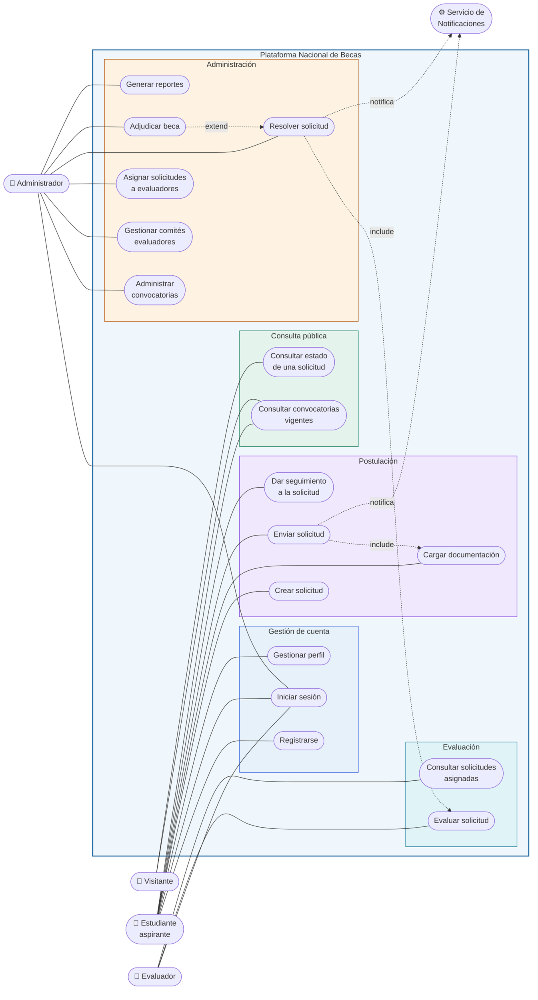

# Diagrama de Casos de Uso
### Anexo 5 §3.1 — Plataforma Nacional para la Gestión Integral de Becas

| | |
|---|---|
| **Responsable** | Fernando (diagramas) · revisado por el equipo |
| **Fecha** | 5 de septiembre de 2026 · **Versión** 1.0 |

> Los diagramas están escritos en **Mermaid dentro de Markdown**, no como imágenes. Así quedan
> versionados como texto: cada cambio se ve línea por línea en el Pull Request, en lugar de un
> archivo binario que nadie puede revisar.

---

## 1. Actores

| Actor | Descripción | Historias |
|---|---|---|
| **Visitante** | Cualquier persona sin cuenta. Consulta convocatorias y estados de solicitud | US-008, US-025, US-027 |
| **Estudiante aspirante** | Guatemalteco que postula a una beca | US-001, US-002, US-004, US-011 a US-016 |
| **Evaluador** | Integrante de un comité que dictamina solicitudes | US-019, US-020 |
| **Administrador** | Personal de la Dirección de Becas del MinEduc | US-006 a US-010, US-017, US-018, US-021, US-023, US-024, US-026, US-028 a US-031 |
| **Servicio de Notificaciones** | Actor secundario. Recibe la orden de notificar | US-022 |

> **Por qué el Visitante es un actor y no un caso particular del Estudiante:** el enunciado exige
> transparencia, y la Visión del Producto define a Don Julio, el padre que consulta el estado del
> expediente de su hijo sin tener cuenta. Si el visitante no fuera actor, esa necesidad
> desaparecería del diseño.

---

## 2. Diagrama

### Relaciones entre casos de uso

| Relación | Significado |
|---|---|
| `CU08 include CU07` | Enviar una solicitud **exige** que la documentación esté cargada. No es opcional |
| `CU15 include CU10` | No se puede resolver una solicitud sin al menos un dictamen registrado |
| `CU16 extend CU15` | Adjudicar la beca **extiende** la resolución: solo ocurre si el resultado fue aprobación |

---

## 3. Detalle de los casos de uso

> El enunciado exige el detalle de cada caso de uso. Se documentan aquí los que cubren los nueve
> objetivos específicos del proyecto. Los casos secundarios siguen esta misma plantilla y sus
> criterios de aceptación están en `docs/04-product-backlog.md`.

---

### CU-01 · Consultar convocatorias vigentes

| | |
|---|---|
| **Actor principal** | Visitante |
| **Historia** | US-008 |
| **Objetivo del enunciado** | Administrar convocatorias (consulta pública) |
| **Precondiciones** | Ninguna. **No requiere cuenta** |
| **Postcondición** | El visitante conoce las convocatorias abiertas y sus requisitos |

**Flujo principal**

1. El visitante abre el listado público de convocatorias.
2. El sistema consulta las convocatorias en estado `PUBLICADA` cuya fecha de cierre no ha pasado.
3. El sistema muestra, por cada una: título, tipo de beca, descripción, código, cupos y fecha de
   cierre, con el plazo restante destacado.
4. El visitante puede filtrar por tipo de beca; el sistema muestra el número de resultados de
   cada tipo antes de aplicar el filtro.

**Flujos alternos**

- **3a. No hay convocatorias vigentes.** El sistema muestra un mensaje explicando que no hay
  procesos abiertos en este momento.
- **4a. El filtro no arroja resultados.** El sistema indica que no hay convocatorias de ese tipo
  y mantiene visible el resto de filtros.

**Flujos de excepción**

- **2a. La base de datos no responde.** El sistema muestra un aviso de error sin detalles
  técnicos y registra el fallo en el log del servidor.

**Requisitos no funcionales aplicables**
Debe responder en menos de 1 segundo. Debe ser usable desde 360 px de ancho.

> ⚠️ **Incumplimiento conocido.** Hoy este caso de uso exige sesión iniciada, lo que contradice
> su propia precondición. Se corrige en el Sprint 3 separando el listado público del panel de
> administración.

---

### CU-02 · Consultar estado de una solicitud

| | |
|---|---|
| **Actor principal** | Visitante |
| **Historia** | US-025 |
| **Objetivo del enunciado** | Consultar el estado de una beca |
| **Precondiciones** | Conocer el número de solicitud y el CUI del solicitante |
| **Postcondición** | El visitante conoce en qué etapa está el expediente |

**Flujo principal**

1. El visitante introduce el número de solicitud y el CUI.
2. El sistema verifica que ambos correspondan a la misma solicitud.
3. El sistema muestra **únicamente** el estado actual y la fecha del último cambio.

**Flujos alternos**

- **2a. La combinación no coincide.** El sistema muestra un mensaje genérico, sin revelar si el
  número de solicitud existe.

**Reglas de negocio**
Nunca se muestran datos personales, documentos ni puntajes. La transparencia del proceso no
puede convertirse en una filtración de datos del solicitante.

---

### CU-04 · Iniciar sesión

| | |
|---|---|
| **Actor principal** | Estudiante, Evaluador o Administrador |
| **Historia** | US-002 · **Implementado** |
| **Precondiciones** | Tener una cuenta activa |
| **Postcondición** | El usuario obtiene un token de sesión válido por 8 horas |

**Flujo principal**

1. El usuario introduce su nombre de usuario y contraseña.
2. El sistema normaliza el nombre de usuario a minúsculas y valida su formato.
3. El sistema busca al usuario.
4. El sistema verifica la contraseña contra el hash bcrypt almacenado.
5. El sistema comprueba que la cuenta esté activa.
6. El sistema emite un token con el identificador, el nombre de usuario y el rol.

**Flujos de excepción**

- **3a. El usuario no existe.** El sistema verifica igualmente contra un hash señuelo antes de
  fallar, para que el tiempo de respuesta no delate qué cuentas existen. Devuelve 401 con
  mensaje genérico.
- **4a. La contraseña es incorrecta.** Devuelve 401 con **el mismo mensaje** que 3a.
- **5a. La cuenta está desactivada.** Devuelve 401 con el mismo mensaje.

**Reglas de negocio**
Los tres fallos devuelven una respuesta idéntica. Distinguirlos permitiría enumerar las cuentas
válidas del sistema.

---

### CU-06 · Crear solicitud

| | |
|---|---|
| **Actor principal** | Estudiante aspirante |
| **Historia** | US-012 |
| **Objetivo del enunciado** | Gestionar solicitudes |
| **Precondiciones** | Sesión iniciada · perfil académico completo · convocatoria publicada y en plazo |
| **Postcondición** | Existe una solicitud en estado `BORRADOR` con número correlativo |

**Flujo principal**

1. El estudiante elige una convocatoria abierta.
2. El sistema comprueba que el perfil del estudiante esté completo.
3. El sistema comprueba que no exista ya una solicitud activa para esa convocatoria.
4. El sistema crea la solicitud en estado `BORRADOR` y le asigna un número correlativo.
5. El sistema muestra la lista de documentos que faltan por cargar.

**Flujos alternos**

- **2a. El perfil está incompleto.** El sistema indica qué datos faltan y lleva al estudiante a
  completarlos.
- **3a. Ya existe una solicitud activa.** El sistema lo informa y ofrece continuar la existente.

**Flujos de excepción**

- **1a. La convocatoria cerró mientras el estudiante navegaba.** El sistema rechaza la creación
  indicando la fecha de cierre.

**Patrón de diseño aplicado**
**State.** El ciclo de vida `BORRADOR → ENVIADA → EN_EVALUACION → APROBADA | RECHAZADA →
ADJUDICADA` se modela como una jerarquía de estados donde cada uno conoce sus transiciones
legales, en vez de condicionales dispersos.

---

### CU-07 · Cargar documentación

| | |
|---|---|
| **Actor principal** | Estudiante aspirante |
| **Historia** | US-013 |
| **Objetivo del enunciado** | Cargar documentación |
| **Precondiciones** | Solicitud en estado `BORRADOR` |
| **Postcondición** | El documento queda asociado al requisito que satisface |

**Flujo principal**

1. El estudiante selecciona el requisito y adjunta el archivo.
2. El sistema valida formato (PDF, JPG, PNG) y tamaño (máximo 5 MB).
3. El sistema almacena el archivo y guarda la referencia junto al requisito.
4. El sistema actualiza la lista de documentos pendientes.

**Flujos alternos**

- **1a. El requisito ya tenía documento.** Se reemplaza, siempre que la solicitud siga en
  `BORRADOR`.

**Flujos de excepción**

- **2a. Formato o tamaño inválido.** El sistema rechaza el archivo indicando el motivo concreto.
- **3a. El almacenamiento falla.** No se guarda referencia alguna: no puede quedar un requisito
  marcado como cumplido sin archivo detrás.

**Patrón de diseño aplicado**
**Adapter.** El dominio declara el puerto `AlmacenamientoDocumentosPort`; en desarrollo lo
implementa un adaptador de disco local y en producción uno de nube.

---

### CU-08 · Enviar solicitud

| | |
|---|---|
| **Actor principal** | Estudiante aspirante |
| **Historia** | US-014 |
| **Precondiciones** | Solicitud en `BORRADOR` con todos los documentos exigidos |
| **Postcondición** | La solicitud pasa a `ENVIADA` y deja de ser editable |

**Flujo principal**

1. El estudiante solicita enviar.
2. El sistema verifica que todos los documentos exigidos estén cargados.
3. El sistema ejecuta la transición a `ENVIADA` y registra fecha y hora.
4. El sistema notifica al estudiante con su número de solicitud.

**Flujos de excepción**

- **2a. Falta documentación.** El sistema **indica exactamente qué falta** y no permite el envío.

**Relación**
`include CU-07`: sin documentación cargada este caso de uso no puede completarse.

---

### CU-10 · Evaluar solicitud

| | |
|---|---|
| **Actor principal** | Evaluador |
| **Historia** | US-019 |
| **Objetivo del enunciado** | Administrar evaluaciones |
| **Precondiciones** | La solicitud está asignada a este evaluador y en estado `EN_EVALUACION` |
| **Postcondición** | Queda registrado un dictamen con puntaje, observación, fecha y autor |

**Flujo principal**

1. El evaluador abre una solicitud de su lista.
2. El sistema muestra los datos del solicitante y sus documentos.
3. El sistema calcula el puntaje según el criterio del tipo de beca.
4. El evaluador escribe una observación justificando su dictamen.
5. El sistema registra el dictamen de forma inmutable.

**Flujos de excepción**

- **1a. La solicitud no le fue asignada.** El sistema devuelve 403, no el recurso.
- **4a. La observación está vacía.** El sistema no permite registrar el dictamen.

**Reglas de negocio**
Un dictamen emitido no se puede modificar. La trazabilidad del proceso lo exige.

**Patrón de diseño aplicado**
**Strategy.** `MeritoAcademico`, `NecesidadSocioeconomica` y `Mixto` son algoritmos
intercambiables. Una política de becas nueva es una clase nueva, no una modificación.

---

### CU-12 · Administrar convocatorias

| | |
|---|---|
| **Actor principal** | Administrador |
| **Historias** | US-006, US-007, US-009, US-010 |
| **Objetivo del enunciado** | Administrar convocatorias |
| **Precondiciones** | Sesión iniciada con rol `ADMINISTRADOR` |
| **Postcondición** | La convocatoria existe en el estado que corresponda |

**Flujo principal (crear y publicar)**

1. El administrador elige el tipo de beca.
2. El sistema propone los requisitos y documentos exigidos por defecto de ese tipo.
3. El administrador completa título, descripción, cupos y fechas.
4. El sistema valida que la fecha de cierre sea posterior a la de apertura y los cupos mayores
   que cero.
5. El sistema crea la convocatoria en estado `BORRADOR`, no visible al público.
6. El administrador la publica; el sistema la pasa a `PUBLICADA`.

**Flujos alternos**

- **6a. Faltan requisitos o documentos.** El sistema impide publicar y señala qué falta.
- Una convocatoria `PUBLICADA` ya no admite cambios en requisitos ni cupos.

**Patrón de diseño aplicado**
**Factory Method.** Cada tipo de beca se construye con sus reglas propias, sin condicionales.

---

### CU-15 · Resolver solicitud

| | |
|---|---|
| **Actor principal** | Administrador |
| **Historia** | US-023 |
| **Objetivo del enunciado** | Aprobar o rechazar solicitudes |
| **Precondiciones** | Solicitud con al menos un dictamen registrado |
| **Postcondición** | La solicitud queda `APROBADA` o `RECHAZADA`, con acta y notificación |

**Flujo principal**

1. El administrador revisa el puntaje consolidado.
2. El administrador decide aprobar o rechazar e introduce el motivo, obligatorio en ambos casos.
3. El sistema verifica los cupos disponibles si la decisión es aprobar.
4. El sistema ejecuta la transición de estado.
5. El sistema registra la auditoría, genera el acta y notifica al estudiante.

**Flujos de excepción**

- **3a. No quedan cupos.** El sistema impide la aprobación.
- **4a. Falla cualquier paso posterior.** La operación se deshace completa: no puede quedar una
  solicitud aprobada sin acta ni un acta sin solicitud aprobada.

**Patrón de diseño aplicado**
**Facade.** `SolicitudFacade` coordina los seis colaboradores y expone una sola operación al
controlador, manteniendo la transaccionalidad en un único lugar.

---

### CU-17 · Generar reportes

| | |
|---|---|
| **Actor principal** | Administrador |
| **Historias** | US-028 a US-031 |
| **Objetivo del enunciado** | Generar reportes básicos |
| **Precondiciones** | Sesión iniciada con rol `ADMINISTRADOR` |
| **Postcondición** | Se produce el reporte en el formato solicitado |

**Flujo principal**

1. El administrador selecciona los filtros: convocatoria, estado, rango de fechas, nivel,
   departamento.
2. El administrador elige la agrupación y el formato de salida.
3. El sistema valida que la combinación de filtros sea coherente.
4. El sistema produce el reporte.

**Flujos de excepción**

- **3a. Combinación incoherente.** Por ejemplo, agrupar por criterio de evaluación en un reporte
  que no incluye evaluaciones. El sistema lo rechaza antes de consultar la base de datos.

**Patrón de diseño aplicado**
**Builder.** La construcción paso a paso permite validar la coherencia en `build()` y evita el
constructor telescópico de ocho parámetros opcionales.

---

## 4. Trazabilidad

| Caso de uso | Objetivo del enunciado | Historias | Patrón | Estado |
|---|---|---|---|---|
| CU-01 | Administrar convocatorias | US-008 | — | 🟡 Parcial |
| CU-02 | Consultar estado de una beca | US-025 | — | 🔴 Sprint 6 |
| CU-03 | Registrar estudiantes | US-001 | — | 🔴 Sprint 2 |
| CU-04 | — (transversal) | US-002 | Adapter | 🟢 **Implementado** |
| CU-06 | Gestionar solicitudes | US-012 | State | 🔴 Sprint 4 |
| CU-07 | Cargar documentación | US-013 | Adapter | 🔴 Sprint 4 |
| CU-08 | Gestionar solicitudes | US-014 | State | 🔴 Sprint 4 |
| CU-10 | Administrar evaluaciones | US-019 | Strategy | 🔴 Sprint 5 |
| CU-12 | Administrar convocatorias | US-006, 007, 009, 010 | Factory Method | 🔴 Sprint 3 |
| CU-13 | Gestionar comités | US-017 | — | 🔴 Sprint 5 |
| CU-15 | Aprobar o rechazar | US-023 | Facade | 🔴 Sprint 6 |
| CU-16 | Aprobar o rechazar | US-024 | — | 🔴 Sprint 6 |
| CU-17 | Generar reportes | US-028 a 031 | Builder | 🔴 Sprint 7 |
