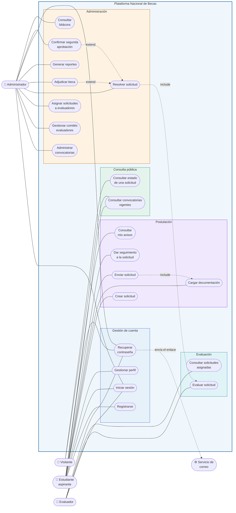

# Diagrama de Casos de Uso
### Anexo 5 §3.1 — Plataforma Nacional para la Gestión Integral de Becas

| | |
|---|---|
| **Responsable** | Fernando (diagramas) · revisado por el equipo |
| **Fecha** | 5 de septiembre de 2026 · **Versión** 1.2 (28 oct: recuperación de contraseña, avisos, segunda aprobación y bitácora) |

> Los diagramas están escritos en Mermaid dentro de Markdown, no como imágenes. Así quedan
> versionados como texto: cada cambio se ve línea por línea en el Pull Request, en lugar de un
> archivo binario que nadie puede revisar.

---

## 1. Actores

| Actor | Descripción | Historias |
|---|---|---|
| **Visitante** | Cualquier persona sin cuenta. Consulta convocatorias y estados de solicitud | US-008, US-025, US-027 |
| **Estudiante aspirante** | Guatemalteco que postula a una beca | US-001, US-002, US-004, US-011 a US-016, US-034, US-035 |
| **Evaluador** | Integrante de un comité que dictamina solicitudes | US-019, US-020, US-035 |
| **Administrador** | Personal de la Dirección de Becas del MinEduc | US-006 a US-010, US-017, US-018, US-021, US-023, US-024, US-026, US-028 a US-033, US-035 |
| **Servicio de correo** | Actor secundario. Entrega el enlace de recuperación de contraseña | US-035 |

> Los avisos por cambio de estado (US-034) no pasan por un servicio externo: quedan guardados en
> la plataforma y el estudiante los ve en **Mis avisos** (CU-19). Por eso el servicio de correo
> solo aparece en la recuperación de contraseña.

> **Por qué el Visitante es un actor y no un caso particular del Estudiante:** el enunciado exige
> transparencia, y la Visión del Producto define a Don Julio, el padre que consulta el estado del
> expediente de su hijo sin tener cuenta. Si el visitante no fuera actor, esa necesidad
> desaparecería del diseño.

---

## 2. Diagrama

### Relaciones entre casos de uso

| Relación | Significado |
|---|---|
| `CU08 include CU07` | Enviar una solicitud **exige** que la documentación esté cargada. No es opcional |
| `CU15 include CU10` | No se puede resolver una solicitud sin al menos un dictamen registrado |
| `CU16 extend CU15` | Adjudicar la beca **extiende** la resolución: solo ocurre si el resultado fue aprobación |
| `CU20 extend CU15` | La segunda aprobación **extiende** la resolución: solo ocurre si la beca supera Q10,000 |

---

## 3. Detalle de los casos de uso

> El enunciado exige el detalle de cada caso de uso, y aquí están los diecisiete, en orden. Cada
> uno documenta actor, precondiciones, postcondición, flujo principal, flujos alternos, flujos de
> excepción y los requisitos no funcionales que le aplican. Los criterios de aceptación de sus
> historias están en `docs/04-product-backlog.md`.
>
> Se detallan también los casos que todavía no están implementados: el detalle es el análisis
> previo, no la documentación de lo ya construido. La columna de estado de §4 dice qué existe hoy.

---

### CU-01 · Consultar convocatorias vigentes

| | |
|---|---|
| **Actor principal** | Visitante |
| **Historia** | US-008 |
| **Objetivo del enunciado** | Administrar convocatorias (consulta pública) |
| **Precondiciones** | Ninguna. **No requiere cuenta** |
| **Postcondición** | El visitante conoce las convocatorias abiertas y sus requisitos |

**Flujo principal**

1. El visitante abre el listado público de convocatorias.
2. El sistema consulta las convocatorias en estado `PUBLICADA` cuya fecha de cierre no ha pasado.
3. El sistema muestra, por cada una: título, tipo de beca, descripción, código, cupos y fecha de
   cierre, con el plazo restante destacado.
4. El visitante puede filtrar por tipo de beca; el sistema muestra el número de resultados de
   cada tipo antes de aplicar el filtro.

**Flujos alternos**

- **3a. No hay convocatorias vigentes.** El sistema muestra un mensaje explicando que no hay
  procesos abiertos en este momento.
- **4a. El filtro no arroja resultados.** El sistema indica que no hay convocatorias de ese tipo
  y mantiene visible el resto de filtros.

**Flujos de excepción**

- **2a. La base de datos no responde.** El sistema muestra un aviso de error sin detalles
  técnicos y registra el fallo en el log del servidor.

**Requisitos no funcionales aplicables**
Debe responder en menos de 1 segundo. Debe ser usable desde 360 px de ancho.

> ✅ **Incumplimiento corregido el 12 de septiembre de 2026.** Hasta entonces este caso de uso
> exigía sesión iniciada, lo que contradecía su propia precondición. El listado público y el panel
> de administración quedaron separados: `/convocatorias` es pública y `/gestion` exige rol.

---

### CU-02 · Consultar estado de una solicitud

| | |
|---|---|
| **Actor principal** | Visitante |
| **Historia** | US-025 |
| **Objetivo del enunciado** | Consultar el estado de una beca |
| **Precondiciones** | Conocer el número de solicitud y el CUI del solicitante |
| **Postcondición** | El visitante conoce en qué etapa está el expediente |

**Flujo principal**

1. El visitante introduce el número de solicitud y el CUI.
2. El sistema verifica que ambos correspondan a la misma solicitud.
3. El sistema muestra únicamente el estado actual y la fecha del último cambio.

**Flujos alternos**

- **2a. La combinación no coincide.** El sistema muestra un mensaje genérico, sin revelar si el
  número de solicitud existe.

**Flujos de excepción**

- **1a. Más de 10 consultas en un minuto desde la misma dirección.** El sistema responde 429 y
  pide esperar. Sin ese límite, se podrían probar combinaciones de número y CUI hasta acertar.

**Reglas de negocio**
Nunca se muestran datos personales, documentos ni puntajes. La transparencia del proceso no
puede convertirse en una filtración de datos del solicitante.

---

### CU-03 · Registrar estudiante

|                            |                                                                    |
| -------------------------- | ------------------------------------------------------------------ |
| **Actor principal**        | Estudiante aspirante                                               |
| **Historia**               | US-001                                                             |
| **Objetivo del enunciado** | Registrar estudiantes                                              |
| **Precondiciones**         | Ninguna. **No requiere cuenta**: este caso de uso es el que la crea |
| **Postcondición**          | Existe una cuenta con rol `ESTUDIANTE`, autenticada y en su panel   |

**Flujo principal**

1. El aspirante abre el formulario de registro.
2. El sistema solicita nombre completo, CUI, correo electrónico y contraseña.
3. El aspirante completa los datos y envía el formulario.
4. El sistema valida que el CUI tenga 13 dígitos y que no exista otro igual.
5. El sistema valida que la contraseña tenga **mínimo 8 caracteres, al menos una mayúscula y un
   número**.
6. El sistema valida que el correo no esté registrado.
7. El sistema calcula el hash bcrypt de la contraseña y crea la cuenta con rol `ESTUDIANTE`.
8. El sistema inicia la sesión automáticamente y redirige al aspirante a su panel.

**Flujos alternos**

- **4a. El CUI ya está registrado.** El sistema informa que ese CUI ya tiene una cuenta y ofrece
  iniciar sesión o recuperar la contraseña. No se crea una segunda cuenta: un CUI es una
  persona.
- **6a. El correo ya está registrado.** Mismo tratamiento que el anterior.

**Flujos de excepción**

- **4b. El CUI no tiene 13 dígitos o contiene letras.** El sistema señala el campo y explica el
  formato esperado, sin borrar el resto de lo que el aspirante ya escribió.
- **5a. La contraseña no cumple la política.** El sistema indica cuál de las tres condiciones
  falta, no un mensaje genérico.
- **7a. La base de datos no responde.** El sistema informa del fallo sin detalles técnicos, no crea
  la cuenta a medias y registra el error en el log.

**Requisitos no funcionales aplicables**

La contraseña se almacena siempre con hash bcrypt, nunca en texto plano ni cifrada de forma
reversible. El formulario debe ser usable desde 360 px de ancho.

> **Por qué aquí los mensajes de error sí son específicos y al iniciar sesión no.** Al registrarse,
> decir "ese CUI ya existe" es necesario para que la persona sepa qué hacer, y no revela nada
> aprovechable: el CUI ya lo conoce quien lo escribió. Al iniciar sesión, en cambio, el mensaje
> es genérico a propósito, porque distinguir "usuario inexistente" de "contraseña incorrecta"
> permitiría averiguar qué usuarios existen. La regla es informar a quien tiene derecho a saber, y
> solo eso.

---

### CU-04 · Iniciar sesión

| | |
|---|---|
| **Actor principal** | Estudiante, Evaluador o Administrador |
| **Historia** | US-002 · **Implementado** |
| **Precondiciones** | Tener una cuenta activa |
| **Postcondición** | El usuario obtiene un token de sesión válido por 8 horas |

**Flujo principal**

1. El usuario introduce su nombre de usuario y contraseña.
2. El sistema normaliza el nombre de usuario a minúsculas y valida su formato.
3. El sistema busca al usuario.
4. El sistema verifica la contraseña contra el hash bcrypt almacenado.
5. El sistema comprueba que la cuenta esté activa.
6. El sistema emite un token con el identificador, el nombre de usuario y el rol.

**Flujos de excepción**

- **3a. El usuario no existe.** El sistema verifica igualmente contra un hash señuelo antes de
  fallar, para que el tiempo de respuesta no delate qué cuentas existen. Devuelve 401 con
  mensaje genérico.
- **4a. La contraseña es incorrecta.** Devuelve 401 con el mismo mensaje que 3a y suma un intento
  fallido.
- **4b. Es el quinto intento fallido seguido.** La cuenta queda bloqueada 15 minutos. Mientras
  dure el bloqueo no se verifica la contraseña, ni siquiera si es correcta, y la respuesta es el
  mismo 401 genérico.
- **5a. La cuenta está desactivada.** Devuelve 401 con el mismo mensaje.

**Flujos alternos**

- **1a. El usuario no recuerda la contraseña.** Sigue CU-18.

**Reglas de negocio**
Los tres fallos devuelven una respuesta idéntica. Distinguirlos permitiría enumerar las cuentas
válidas del sistema.

---

### CU-06 · Crear solicitud

| | |
|---|---|
| **Actor principal** | Estudiante aspirante |
| **Historia** | US-012 |
| **Objetivo del enunciado** | Gestionar solicitudes |
| **Precondiciones** | Sesión iniciada · perfil académico completo · convocatoria publicada y en plazo |
| **Postcondición** | Existe una solicitud en estado `BORRADOR` con número correlativo |

**Flujo principal**

1. El estudiante elige una convocatoria abierta.
2. El sistema comprueba que el perfil del estudiante esté completo.
3. El sistema comprueba que no exista ya una solicitud activa para esa convocatoria.
4. El sistema crea la solicitud en estado `BORRADOR` y le asigna un número correlativo.
5. El sistema muestra la lista de documentos que faltan por cargar.

**Flujos alternos**

- **2a. El perfil está incompleto.** El sistema indica qué datos faltan y lleva al estudiante a
  completarlos.
- **3a. Ya existe una solicitud activa.** El sistema lo informa y ofrece continuar la existente.

**Flujos de excepción**

- **1a. La convocatoria cerró mientras el estudiante navegaba.** El sistema rechaza la creación
  indicando la fecha de cierre.

**Patrón de diseño aplicado**
**State.** El ciclo de vida `BORRADOR → ENVIADA → EN_EVALUACION → APROBADA | RECHAZADA →
ADJUDICADA` se modela como una jerarquía de estados donde cada uno conoce sus transiciones
legales, en vez de condicionales dispersos. El estado `APROBACION_PENDIENTE` (CU-20) se agregó
después como una clase más, sin tocar las existentes.

---

### CU-07 · Cargar documentación

| | |
|---|---|
| **Actor principal** | Estudiante aspirante |
| **Historia** | US-013 |
| **Objetivo del enunciado** | Cargar documentación |
| **Precondiciones** | Solicitud en estado `BORRADOR` |
| **Postcondición** | El documento queda asociado al requisito que satisface |

**Flujo principal**

1. El estudiante selecciona el requisito y adjunta el archivo.
2. El sistema valida formato (PDF, JPG, PNG) y tamaño (máximo 5 MB).
3. El sistema almacena el archivo y guarda la referencia junto al requisito.
4. El sistema actualiza la lista de documentos pendientes.

**Flujos alternos**

- **1a. El requisito ya tenía documento.** Se reemplaza, siempre que la solicitud siga en
  `BORRADOR`.

**Flujos de excepción**

- **2a. Formato o tamaño inválido.** El sistema rechaza el archivo indicando el motivo concreto.
- **3a. El almacenamiento falla.** No se guarda referencia alguna: no puede quedar un requisito
  marcado como cumplido sin archivo detrás.

**Patrón de diseño aplicado**
**Adapter.** El dominio declara el puerto `AlmacenamientoDocumentos`. Lo implementan
`AlmacenamientoLocalAdapter`, que guarda en disco, y `AlmacenamientoMemoriaAdapter`, para las
pruebas. Un adaptador de nube sería una clase más; no se construyó.

---

### CU-08 · Enviar solicitud

| | |
|---|---|
| **Actor principal** | Estudiante aspirante |
| **Historia** | US-014 |
| **Precondiciones** | Solicitud en `BORRADOR` con todos los documentos exigidos |
| **Postcondición** | La solicitud pasa a `ENVIADA` y deja de ser editable |

**Flujo principal**

1. El estudiante solicita enviar.
2. El sistema verifica que todos los documentos exigidos estén cargados.
3. El sistema ejecuta la transición a `ENVIADA` y registra fecha y hora.
4. El sistema deja un aviso al estudiante con su número de solicitud (CU-19).

**Flujos de excepción**

- **2a. Falta documentación.** El sistema indica exactamente qué falta y no permite el envío.

**Relación**
`include CU-07`: sin documentación cargada este caso de uso no puede completarse.

---

### CU-10 · Evaluar solicitud

| | |
|---|---|
| **Actor principal** | Evaluador |
| **Historia** | US-019 |
| **Objetivo del enunciado** | Administrar evaluaciones |
| **Precondiciones** | La solicitud está asignada a este evaluador y en estado `EN_EVALUACION` |
| **Postcondición** | Queda registrado un dictamen con puntaje, observación, fecha y autor |

**Flujo principal**

1. El evaluador abre una solicitud de su lista.
2. El sistema muestra los datos del solicitante y sus documentos.
3. El sistema calcula el puntaje según el criterio del tipo de beca.
4. El evaluador escribe una observación justificando su dictamen.
5. El sistema registra el dictamen de forma inmutable.

**Flujos de excepción**

- **1a. La solicitud no le fue asignada.** El sistema devuelve 403, no el recurso.
- **4a. La observación está vacía.** El sistema no permite registrar el dictamen.

**Reglas de negocio**
Un dictamen emitido no se puede modificar. La trazabilidad del proceso lo exige.

**Patrón de diseño aplicado**
**Strategy.** `MeritoAcademico`, `NecesidadSocioeconomica` y `Mixto` son algoritmos
intercambiables. Una política de becas nueva es una clase nueva, no una modificación.

---

### CU-12 · Administrar convocatorias

| | |
|---|---|
| **Actor principal** | Administrador |
| **Historias** | US-006, US-007, US-009, US-010 |
| **Objetivo del enunciado** | Administrar convocatorias |
| **Precondiciones** | Sesión iniciada con rol `ADMINISTRADOR` |
| **Postcondición** | La convocatoria existe en el estado que corresponda |

**Flujo principal (crear y publicar)**

1. El administrador elige el tipo de beca.
2. El sistema propone los requisitos y documentos exigidos por defecto de ese tipo.
3. El administrador completa título, descripción, cupos y fechas.
4. El sistema valida que la fecha de cierre sea posterior a la de apertura y los cupos mayores
   que cero.
5. El sistema crea la convocatoria en estado `BORRADOR`, no visible al público.
6. El administrador la publica; el sistema la pasa a `PUBLICADA`.

**Flujos alternos**

- **6a. Faltan requisitos o documentos.** El sistema impide publicar y señala qué falta.
- Una convocatoria `PUBLICADA` ya no admite cambios en requisitos ni cupos.

**Patrón de diseño aplicado**
**Factory Method.** Cada tipo de beca se construye con sus reglas propias, sin condicionales.

---

### CU-13 · Gestionar comités evaluadores

|                            |                                                                                                              |
| -------------------------- | ------------------------------------------------------------------------------------------------------------ |
| **Actor principal**        | Administrador                                                                                                |
| **Historia**               | US-017                                                                                                       |
| **Objetivo del enunciado** | Gestionar comités evaluadores                                                                                |
| **Precondiciones**         | Sesión con rol `ADMINISTRADOR` · existir al menos una convocatoria y un usuario con rol `EVALUADOR`           |
| **Postcondición**          | Existe un comité con evaluadores asignados a una convocatoria                                                |

**Flujo principal**

1. El administrador abre la gestión de comités.
2. El sistema muestra los comités existentes con su convocatoria y sus integrantes.
3. El administrador crea un comité, le da nombre y elige la convocatoria que evaluará.
4. El sistema lista los usuarios con rol `EVALUADOR` disponibles.
5. El administrador selecciona los integrantes.
6. El sistema valida que el comité tenga al menos un evaluador y que ninguno esté repetido.
7. El sistema guarda el comité y registra quién lo creó y cuándo.

**Flujos alternos**

- **2a. No hay comités.** El sistema lo indica y ofrece crear el primero.
- **4a. No hay usuarios con rol `EVALUADOR`.** El sistema explica que primero hay que asignar ese
  rol a alguien, y no permite crear un comité vacío.
- **5a. Se quita a un integrante que ya tiene solicitudes asignadas.** El sistema advierte cuántas
  solicitudes quedarían sin evaluador y pide confirmación explícita.

**Flujos de excepción**

- **3a. La convocatoria elegida ya tiene un comité.** El sistema lo informa y ofrece editar el
  existente. Una convocatoria tiene un solo comité, según el diagrama de clases.
- **6a. El comité queda sin evaluadores.** El sistema rechaza la operación: un comité sin
  integrantes no puede dictaminar nada.
- **7a. La base de datos no responde.** No se guarda nada parcialmente y se informa del fallo.

**Requisitos no funcionales aplicables**

Toda creación o modificación de un comité queda en el registro de auditoría, que **no se puede
modificar ni eliminar desde la aplicación**.

> **Este caso de uso es más delicado de lo que parece.** No mueve dinero ni cambia estados de
> solicitudes, pero define quién puede ver qué: un evaluador asignado a un comité accede a las
> solicitudes de esa convocatoria. Un error aquí es una fuga de datos personales de aspirantes, no
> una molestia administrativa. Por eso exige rol `ADMINISTRADOR` y queda auditado.

---

### CU-15 · Resolver solicitud

| | |
|---|---|
| **Actor principal** | Administrador |
| **Historia** | US-023 |
| **Objetivo del enunciado** | Aprobar o rechazar solicitudes |
| **Precondiciones** | Solicitud en `EN_EVALUACION` con al menos un dictamen registrado |
| **Postcondición** | La solicitud queda `APROBADA`, `RECHAZADA` o `APROBACION_PENDIENTE`, con su motivo en el historial y un aviso al estudiante |

**Flujo principal**

1. El administrador revisa el puntaje consolidado.
2. El administrador decide aprobar o rechazar y escribe el motivo, obligatorio en ambos casos
   (al menos 15 caracteres).
3. Si la decisión es aprobar, el sistema verifica que quede cupo.
4. El sistema ejecuta la transición de estado y la anota en el historial con autor, fecha y
   motivo. Al aprobar, la solicitud ocupa un cupo.
5. El sistema deja un aviso al estudiante (CU-19).

**Flujos alternos**

- **4a. La beca supera Q10,000 y la decisión es aprobar.** La solicitud pasa a
  `APROBACION_PENDIENTE` y todavía no ocupa cupo. Falta la segunda aprobación (CU-20).

**Flujos de excepción**

- **2a. El motivo falta o es demasiado corto.** El sistema no resuelve.
- **3a. No quedan cupos.** El sistema impide la aprobación. La comprobación definitiva se repite
  dentro de la misma transacción que cambia el estado, para que dos aprobaciones simultáneas no
  ocupen el último cupo dos veces.
- **5a. Falla el aviso.** La resolución no se deshace: ya ocurrió y es válida. El fallo queda en el
  log del servidor.

**Patrón de diseño aplicado**
**Facade.** `ResolucionFacade` coordina dictámenes, cupos, la transición de estado y el aviso, y
expone una sola operación al controlador.

> El acta de resolución (US-026) no se implementó.

---

### CU-16 · Adjudicar beca

|                            |                                                                                                      |
| -------------------------- | ---------------------------------------------------------------------------------------------------- |
| **Actor principal**        | Administrador                                                                                        |
| **Historia**               | US-024                                                                                               |
| **Objetivo del enunciado** | Aprobar o rechazar solicitudes (adjudicación formal)                                                 |
| **Precondiciones**         | Sesión con rol `ADMINISTRADOR` · solicitud en estado `APROBADA` · cupo disponible en la convocatoria  |
| **Postcondición**          | La solicitud queda `ADJUDICADA` y existe una `Beca` con su código y fecha de otorgamiento             |

**Flujo principal**

1. El administrador abre el consolidado de una convocatoria.
2. El sistema muestra, junto a la lista, cuántos cupos quedan disponibles.
3. El administrador elige una solicitud `APROBADA` y confirma la adjudicación.
4. El sistema verifica que esa persona no tenga ya otra beca adjudicada.
5. El sistema crea la `Beca` con su código y la fecha de otorgamiento.
6. El sistema cambia el estado de la solicitud a `ADJUDICADA` y lo registra en su historial.
7. El sistema deja un aviso al estudiante con el código de la beca (CU-19).

> **El cupo no se descuenta aquí.** Se ocupa al aprobar (CU-15 o CU-20). Así, cuando la
> convocatoria se queda sin cupo, el sistema impide aprobar de más, y adjudicar nunca puede
> fallar por falta de cupo.

**Flujos alternos**

- **1a. No hay solicitudes aprobadas.** No aparece ninguna para adjudicar: hay que resolver antes.

**Flujos de excepción**

- **3a. La solicitud no está `APROBADA`.** El estado rechaza la transición: adjudicar una solicitud
  en `BORRADOR`, `RECHAZADA` o `APROBACION_PENDIENTE` lanza una excepción de dominio. Lo impide el
  patrón State, no una comprobación dispersa.
- **4a. La persona ya tiene una beca adjudicada.** El sistema rechaza la adjudicación: una persona,
  una beca. Postular a varias convocatorias sí se permite; el control está aquí porque este es el
  acto que compromete los fondos.
- **7a. Falla el aviso.** La adjudicación no se revierte: la beca ya está otorgada. El fallo queda
  en el log del servidor.

**Requisitos no funcionales aplicables**

La creación de la beca y el cambio de estado ocurren en una sola transacción. La adjudicación
queda en la bitácora (CU-21), que la aplicación no puede modificar.

> **Este es el caso de uso con más consecuencias del sistema.** Es el momento en que el Estado
> otorga un beneficio económico a una persona concreta, y es irreversible en la práctica. Por eso
> el estado solo transiciona desde `APROBADA`, una persona no puede recibir dos becas y la
> operación queda registrada en una bitácora que nadie puede alterar desde la aplicación.

> El acta de resolución (US-026) no se implementó.

---

### CU-17 · Generar reportes

| | |
|---|---|
| **Actor principal** | Administrador |
| **Historias** | US-028 a US-031 |
| **Objetivo del enunciado** | Generar reportes básicos |
| **Precondiciones** | Sesión iniciada con rol `ADMINISTRADOR` |
| **Postcondición** | Se produce el reporte en el formato solicitado |

**Flujo principal**

1. El administrador selecciona los filtros: convocatoria, estado, rango de fechas, nivel,
   departamento.
2. El administrador elige la agrupación y el formato de salida.
3. El sistema valida que la combinación de filtros sea coherente.
4. El sistema produce el reporte.

**Flujos de excepción**

- **3a. Combinación incoherente.** Por ejemplo, agrupar por criterio de evaluación en un reporte
  que no incluye evaluaciones. El sistema lo rechaza antes de consultar la base de datos.

**Patrón de diseño aplicado**
**Builder.** La construcción paso a paso permite validar la coherencia en `build()` y evita el
constructor telescópico de ocho parámetros opcionales.

---

### CU-18 · Recuperar contraseña

| | |
|---|---|
| **Actor principal** | Estudiante, Evaluador o Administrador |
| **Actor secundario** | Servicio de correo |
| **Historia** | US-035 |
| **Precondiciones** | Ninguna sesión iniciada. Tener acceso al correo con el que se registró |
| **Postcondición** | La cuenta tiene una contraseña nueva y queda desbloqueada. No se inicia sesión |

**Flujo principal**

1. El usuario, en la pantalla de acceso, elige **¿Olvidó su contraseña?** y escribe su correo.
2. El sistema responde que, si existe una cuenta con ese correo, recibirá un enlace.
3. Si la cuenta existe, el sistema crea un permiso de recuperación que vence en una hora, guarda
   solo su hash y envía el enlace por correo.
4. El usuario abre el enlace y escribe la contraseña nueva dos veces.
5. El sistema valida la contraseña con la misma política del registro.
6. El sistema guarda el hash de la contraseña nueva, marca el permiso como usado, invalida los
   demás permisos vigentes de esa persona y desbloquea la cuenta.
7. El sistema lleva al usuario a la pantalla de acceso (CU-04).

**Flujos alternos**

- **3a. No existe una cuenta con ese correo.** El sistema no envía nada, pero la respuesta del
  paso 2 es idéntica, carácter por carácter.

**Flujos de excepción**

- **1a. Más de cinco pedidos en 15 minutos desde la misma dirección.** El sistema responde 429.
- **4a. El enlace no existe, venció o ya se usó.** El sistema muestra el mismo mensaje en los tres
  casos y ofrece pedir otro.
- **5a. La contraseña no cumple la política.** El sistema indica qué condición falta.

**Reglas de negocio**

La respuesta nunca revela si un correo está registrado. En un sistema de becas, esa lista dice
quién pidió ayuda económica al Estado.

**Patrón de diseño aplicado**

**Adapter.** El puerto `EnviadorCorreo` tiene dos adaptadores: `CorreoConsolaAdapter`, que escribe
el mensaje en el log del servidor, y `CorreoSmtpAdapter`. Se elige con la variable `CORREO_TIPO`.
El de SMTP no está verificado contra un servidor real, así que hoy se usa el de consola.

---

### CU-19 · Consultar mis avisos

| | |
|---|---|
| **Actor principal** | Estudiante aspirante |
| **Historia** | US-034 |
| **Precondiciones** | Sesión iniciada con rol `ESTUDIANTE` |
| **Postcondición** | El estudiante conoce los cambios de estado de sus solicitudes |

**Flujo principal**

1. Cada vez que una solicitud del estudiante cambia de estado, el sistema guarda un aviso con el
   estado anterior, el nuevo y, si lo hay, el motivo.
2. El estudiante abre **Mis avisos**.
3. El sistema muestra sus avisos, con los no leídos marcados.
4. El estudiante marca uno como leído, o todos a la vez.

**Flujos alternos**

- **1a. La solicitud se acaba de crear.** No se genera aviso: el estado inicial no es un cambio.
- **3a. No hay avisos.** El sistema lo indica.

**Flujos de excepción**

- **1b. El aviso no se puede guardar.** La operación que cambió el estado no se cae: ya ocurrió y
  es válida. El fallo queda en el log.
- **4a. El aviso es de otro estudiante.** El sistema lo trata como inexistente.

**Patrón de diseño aplicado**

**Observer.** La solicitud acumula los cambios de estado que le ocurren y el caso de uso los
publica después de guardarla. Así nunca se avisa de algo que no llegó a la base de datos, y la
solicitud no sabe quién la observa.

---

### CU-20 · Confirmar segunda aprobación

| | |
|---|---|
| **Actor principal** | Administrador, distinto del que dio la primera aprobación |
| **Historia** | US-033 |
| **Precondiciones** | Solicitud en `APROBACION_PENDIENTE` |
| **Postcondición** | La solicitud queda `APROBADA` y ocupa un cupo |

**Flujo principal**

1. El administrador abre el consolidado y ve la solicitud en **Aprobación pendiente**.
2. El administrador elige **Segunda aprobación** y escribe su motivo.
3. El sistema verifica que quede cupo.
4. El sistema verifica que quien confirma no sea quien dio la primera aprobación.
5. El sistema pasa la solicitud a `APROBADA`, ocupa el cupo y lo anota en el historial.
6. El sistema deja un aviso al estudiante (CU-19).

**Flujos alternos**

- **2a. El administrador no está de acuerdo.** Puede rechazar la solicitud desde ese mismo estado,
  con su motivo (CU-15).

**Flujos de excepción**

- **3a. No quedan cupos.** El sistema impide la confirmación.
- **4a. Es la misma persona de la primera aprobación.** El sistema lo rechaza: el objetivo es que
  una sola persona no pueda comprometer un monto alto.

**Patrón de diseño aplicado**

**State.** `APROBACION_PENDIENTE` es la clase `EstadoAprobacionPendiente`, que solo permite
confirmar o rechazar. Se agregó sin modificar los demás estados.

---

### CU-21 · Consultar bitácora

| | |
|---|---|
| **Actor principal** | Administrador |
| **Historia** | US-032 |
| **Precondiciones** | Sesión iniciada con rol `ADMINISTRADOR` |
| **Postcondición** | El administrador conoce quién hizo qué, cuándo y con qué resultado. La consulta queda registrada |

**Flujo principal**

1. Cada operación que cambia datos, aceptada o rechazada, queda registrada con autor, rol,
   operación, recurso, resultado y fecha. No se guarda el cuerpo de la petición.
2. El administrador abre **Bitácora**.
3. El administrador filtra por fechas, actor, recurso o solo las rechazadas.
4. El sistema muestra los registros, de 50 en 50.

**Flujos alternos**

- **4a. Ningún registro coincide.** El sistema lo indica.

**Flujos de excepción**

- **2a. El usuario no es administrador.** El sistema responde 403, y ese intento también queda
  registrado.

**Reglas de negocio**

Ningún registro se puede modificar ni borrar desde la aplicación. Las consultas de solo lectura
no se registran, salvo la consulta a la propia bitácora.

---

---

## 4. Trazabilidad

| Caso de uso | Objetivo del enunciado | Historias | Patrón | Estado |
|---|---|---|---|---|
| CU-01 | Administrar convocatorias | US-008 | — | 🟢 Criterios cumplidos · verificado en Staging |
| CU-02 | Consultar estado de una beca | US-025 | — | 🟢 Criterios cumplidos · verificado en Staging |
| CU-03 | Registrar estudiantes | US-001 | — | 🟢 Criterios cumplidos · verificado en Staging |
| CU-04 | — (transversal) | US-002 | Adapter | 🟢 **Implementado** |
| CU-06 | Gestionar solicitudes | US-012 | State | 🟢 Criterios cumplidos · verificado en Staging |
| CU-07 | Cargar documentación | US-013 | Adapter | 🟢 Criterios cumplidos, incluido el flujo 3a · verificado en Staging |
| CU-08 | Gestionar solicitudes | US-014 | State | 🟢 Criterios cumplidos · verificado en Staging |
| CU-10 | Administrar evaluaciones | US-019 | Strategy | 🟢 Criterios cumplidos, incluido el 403 de 1a · verificado en Staging |
| CU-12 | Administrar convocatorias | US-006, 007, 009, 010 | Factory Method | 🟡 Crear y publicar hechos · faltan cerrar (US-009) y editar (US-010) |
| CU-13 | Gestionar comités | US-017 | — | 🟢 Completo: crear, agregar y quitar integrantes, con 3a, 4a, 5a y 6a · quitar integrantes está sin verificar en Staging |
| CU-15 | Aprobar o rechazar | US-023 | Facade | 🟢 Criterios cumplidos · sin acta (US-026) · verificado en Staging |
| CU-16 | Aprobar o rechazar | US-024 | — | 🟢 Implementado · verificado en Staging |
| CU-17 | Generar reportes | US-028 a 031 | Builder | 🟢 Implementado · verificado en Staging |
| CU-18 | — (transversal) | US-035 | Adapter | 🟢 Implementado con el correo de consola · pendiente de verificar en Staging |
| CU-19 | Consultar el estado de una beca | US-034 | Observer | 🟢 Implementado · verificado en Staging |
| CU-20 | Aprobar o rechazar | US-033 | State | 🟢 Implementado · verificado en Staging |
| CU-21 | — (transversal) | US-032 | — | 🟢 Implementado · verificado en Staging |
