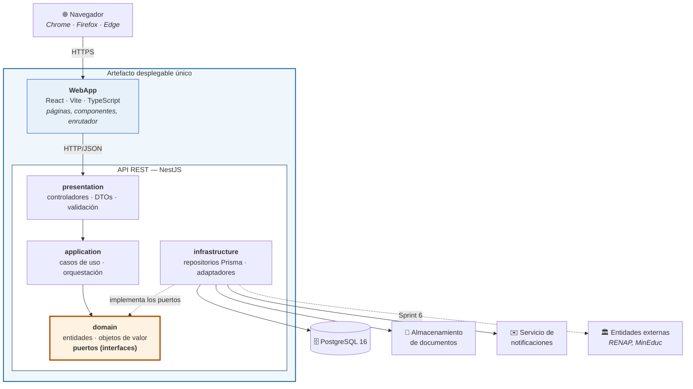
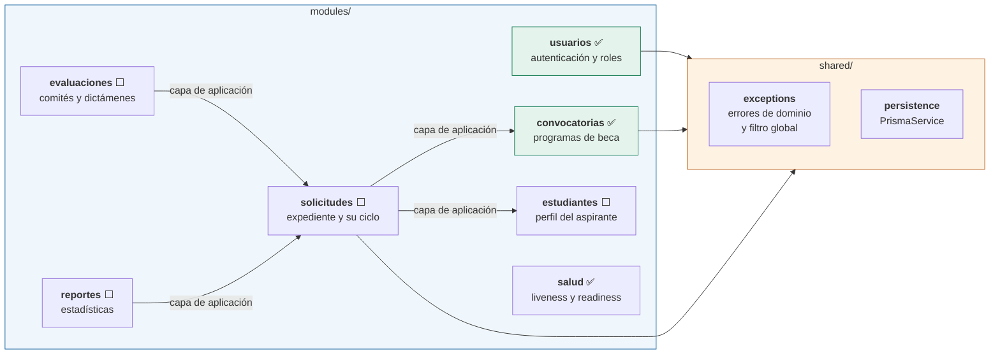
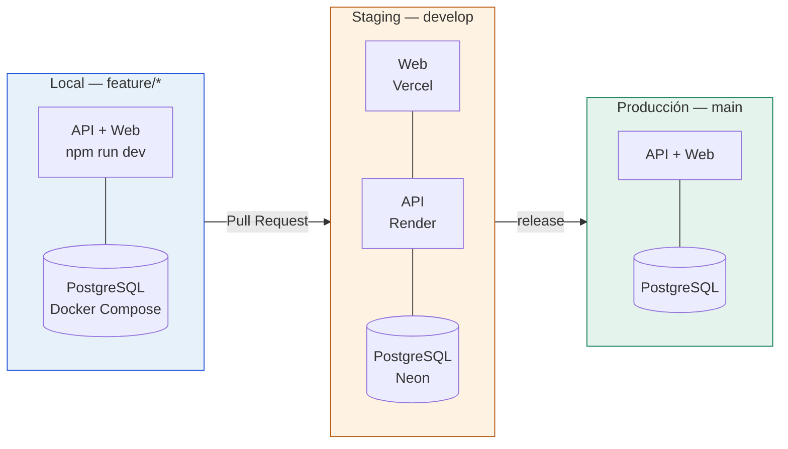

# Diagrama de Componentes
### Anexo 5 §3.2 — Plataforma Nacional para la Gestión Integral de Becas

| | |
|---|---|
| **Responsable** | Fernando (diagramas) · revisado por el equipo |
| **Fecha** | 5 de septiembre de 2026 · **Versión** 1.1 (11 sep: verificado contra el código) |

> Este diagrama debe reflejar la arquitectura elegida —monolito modular en capas con puertos y
> adaptadores— y mostrar **las interfaces**, no solo las cajas. Las flechas indican dependencia:
> quien apunta, depende.

---

## 1. Vista general del sistema



**La única flecha que hay que entender** es la punteada de `infrastructure` hacia `domain`.

En una arquitectura tradicional el negocio dependería de la base de datos: la flecha iría al
revés. Aquí está **invertida**. El dominio declara qué necesita y la infraestructura obedece.

Por eso `domain` aparece resaltado: **todas las flechas apuntan hacia él y él no apunta a nadie.**

---

## 2. Módulos de negocio

El monolito está dividido por dentro. Cada módulo repite las cuatro capas.



✅ construido · ⬜ pendiente

**Regla de comunicación entre módulos.** Un módulo solo llama a **la capa de aplicación** de
otro. Nunca importa sus entidades de dominio ni su repositorio.

Es la mitigación del riesgo que documentamos como *"monolito distribuido interno"*: si los
módulos se importaran libremente entre sí, tendríamos las desventajas de los microservicios sin
ninguna de sus ventajas. Se verifica en cada code review.

---

## 3. Interfaces expuestas

### Del sistema hacia afuera

| Interfaz | Consumidor | Estado |
|---|---|---|
| `POST /auth/login` | WebApp | 🟢 Implementada |
| `GET /convocatorias` | WebApp | 🟢 Implementada |
| `GET /health` | Monitoreo · CI | 🟢 Implementada — *liveness*: responde si el proceso vive |
| `GET /ready` | Monitoreo · CI · Staging | 🟢 Implementada — *readiness*: 503 si PostgreSQL no responde |
| `POST /solicitudes` | WebApp | 🔴 Sprint 4 |
| `GET /consulta-publica/{numero}` | WebApp, sin autenticación | 🔴 Sprint 6 |

### Puertos que el dominio declara

Esta es la tabla que demuestra la inversión de dependencias. Cada puerto es una interfaz escrita
en `domain/`; cada adaptador la implementa en `infrastructure/`.

| Puerto (domain) | Adaptadores (infrastructure) | Módulo | Estado |
|---|---|---|---|
| `UsuarioRepositorio` | `UsuarioPrismaRepositorio`<br/>`UsuarioEnMemoriaRepositorio` | usuarios | 🟢 |
| `HasherPassword` | `BcryptHasherAdapter` | usuarios | 🟢 |
| `GeneradorToken` | `JwtGeneradorTokenAdapter` | usuarios | 🟢 |
| `VerificadorToken` | `JwtVerificadorTokenAdapter` | usuarios | 🟢 — lo consume el guard global (US-003) |
| `ConvocatoriaRepositorio` | `ConvocatoriaPrismaRepositorio`<br/>`ConvocatoriaEnMemoriaRepositorio` | convocatorias | 🟢 |
| `AlmacenamientoDocumentosPort` | `AlmacenamientoLocalAdapter`<br/>`AlmacenamientoNubeAdapter` | solicitudes | 🔴 Sprint 4 |
| `NotificacionPort` | `NotificacionConsolaAdapter`<br/>`NotificacionCorreoAdapter` | solicitudes | 🔴 Sprint 5 |

> **Que cada puerto tenga dos adaptadores no es casualidad.** Uno real y uno de prueba. Es lo que
> permite que las 72 pruebas unitarias corran en segundos sin levantar PostgreSQL, y es la demostración
> práctica del principio de sustitución de Liskov.

---

## 4. Cómo se enlazan puerto y adaptador

El enlace ocurre en **un solo archivo por módulo**, la raíz de composición:

```ts
// modules/usuarios/usuarios.module.ts
providers: [
  AutenticarUsuarioService,
  { provide: USUARIO_REPOSITORIO, useClass: UsuarioPrismaRepositorio },
  { provide: HASHER_PASSWORD,     useClass: BcryptHasherAdapter },
  { provide: GENERADOR_TOKEN,     useClass: JwtGeneradorTokenAdapter },
]
```

Migrar de bcrypt a argon2, o de JWT a sesiones en servidor, es **cambiar una línea**. Ni la
entidad, ni el caso de uso, ni el controlador se enteran.

---

## 5. Verificación automática de la regla de capas

La regla no depende de que el revisor se acuerde. Está codificada en `eslint.config.mjs`:

```
domain/        → prohibido importar @nestjs/*, @prisma/client, express
application/   → prohibido importar infrastructure/
```

Si alguien la viola, ESLint falla y el CI bloquea el Pull Request. Se comprobó provocando la
violación a propósito.

---

## 6. Entornos de despliegue



> ⚠️ **Staging no está desplegado todavía.** Es el bloqueo más grande del proyecto: la Definition
> of Done exige que cada historia esté desplegada y verificada por el Product Owner, así que
> mientras no exista, **ninguna historia puede darse por terminada**. Responsable: Ivan.
