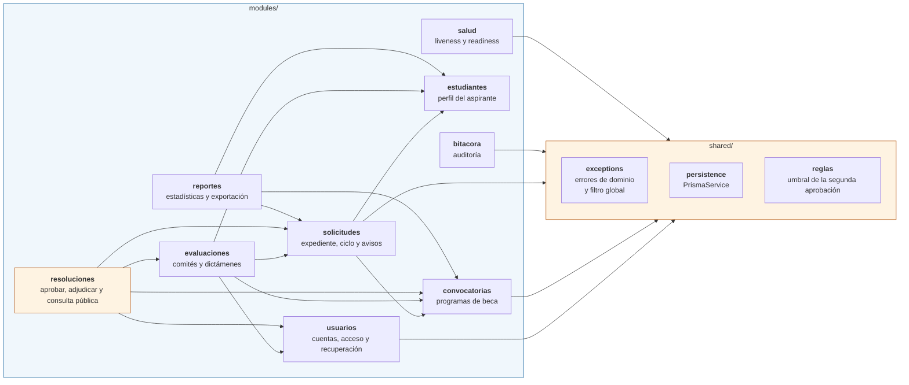
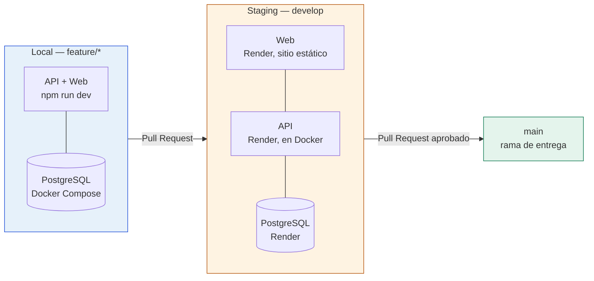

# Diagrama de Componentes
### Anexo 5 §3.2 — Plataforma Nacional para la Gestión Integral de Becas

| | |
|---|---|
| **Responsable** | Fernando (diagramas) · revisado por el equipo |
| **Fecha** | 5 de septiembre de 2026 · **Versión** 1.3 (28 oct: los nueve módulos, los puertos actuales y el despliegue real) |

> Este diagrama debe reflejar la arquitectura elegida —monolito modular en capas con puertos y
> adaptadores— y mostrar las interfaces, no solo las cajas. Las flechas indican dependencia:
> quien apunta, depende.

---

## 1. Vista general del sistema


La flecha que concentra la decisión de diseño es la punteada, de `infrastructure` hacia `domain`.

En una arquitectura tradicional la lógica de negocio dependería de la base de datos y la flecha
iría en sentido contrario. Aquí está invertida: el dominio declara lo que necesita mediante
interfaces y la infraestructura las implementa.

`domain` aparece resaltado porque todas las dependencias apuntan hacia él y ninguna sale de él.

---

## 2. Módulos de negocio

El monolito está dividido por dentro. Cada módulo repite las cuatro capas.



Cada flecha entre módulos pasa por la capa de aplicación. `resoluciones` está resaltado porque es el módulo más alto: depende de cuatro y nadie depende de él.
`bitacora` no depende de ningún otro módulo: la escribe un middleware global y los demás ni lo
mencionan.

**Regla de comunicación entre módulos.** Un módulo solo llama a la capa de aplicación de
otro. Nunca importa sus entidades de dominio ni su repositorio.

Es la mitigación del riesgo que documentamos como *"monolito distribuido interno"*: si los
módulos se importaran libremente entre sí, tendríamos las desventajas de los microservicios sin
ninguna de sus ventajas. Se verifica en cada code review.

---

## 3. Interfaces expuestas

### Del sistema hacia afuera

| Interfaz | Consumidor | Estado |
|---|---|---|
| `/auth/*`: login, registro y recuperación de contraseña | WebApp | 🟢 |
| `/convocatorias/*` | WebApp | 🟢 |
| `/estudiantes/*` | WebApp | 🟢 |
| `/solicitudes/*` y `/notificaciones/*` | WebApp | 🟢 |
| `/evaluadores`, `/comites/*` y `/evaluaciones/*` | WebApp | 🟢 |
| `/resoluciones/*` | WebApp | 🟢 |
| `POST /consulta-publica` | WebApp, sin autenticación | 🟢 |
| `/reportes/*` | WebApp | 🟢 |
| `/bitacora/*` | WebApp | 🟢 |
| `GET /health` | Monitoreo · CI | 🟢 *Liveness*: responde si el proceso vive |
| `GET /ready` | Monitoreo · CI · Staging | 🟢 *Readiness*: 503 si PostgreSQL no responde |

El detalle de cada ruta, con su rol y sus códigos de error, está en `20-manual-tecnico.md §4.1`.

### Puertos que el dominio declara

Esta es la tabla que demuestra la inversión de dependencias. Cada puerto es una interfaz escrita
en `domain/`; cada adaptador la implementa en `infrastructure/`.

| Puerto (domain) | Adaptadores (infrastructure) | Módulo | Estado |
|---|---|---|---|
| `UsuarioRepositorio` | `UsuarioPrismaRepositorio`<br/>`UsuarioEnMemoriaRepositorio` | usuarios | 🟢 |
| `HasherPassword` | `BcryptHasherAdapter` | usuarios | 🟢 |
| `GeneradorToken` | `JwtGeneradorTokenAdapter` | usuarios | 🟢 |
| `VerificadorToken` | `JwtVerificadorTokenAdapter` | usuarios | 🟢 — lo consume el guard global (US-003) |
| `ConvocatoriaRepositorio` | `ConvocatoriaPrismaRepositorio`<br/>`ConvocatoriaEnMemoriaRepositorio` | convocatorias | 🟢 |
| `EnviadorCorreo` | `CorreoConsolaAdapter`<br/>`CorreoSmtpAdapter` | usuarios | 🟢 El SMTP no está verificado contra un servidor real |
| `TokenRecuperacionRepositorio` | `TokenRecuperacionPrismaRepositorio`<br/>`TokenRecuperacionEnMemoriaRepositorio` | usuarios | 🟢 |
| `AlmacenamientoDocumentos` | `AlmacenamientoLocalAdapter`<br/>`AlmacenamientoMemoriaAdapter` | solicitudes | 🟢 El de nube no existe |
| `NotificadorSolicitudes` | `NotificadorConsolaAdapter` | solicitudes | 🟢 |
| `NotificacionRepositorio` | `NotificacionPrismaRepositorio`<br/>`NotificacionEnMemoriaRepositorio` | solicitudes | 🟢 La bandeja de avisos (US-034) |
| `BitacoraRepositorio` | `BitacoraPrismaRepositorio`<br/>`BitacoraEnMemoriaRepositorio` | bitacora | 🟢 Solo escribe y lee |
| `ExportadorReporte` | `CsvExportador`<br/>`PdfExportador` | reportes | 🟢 |

> Los puertos de persistencia tienen un adaptador real y uno en memoria para las pruebas. Es lo
> que permite que las 504 pruebas unitarias corran en segundos sin levantar PostgreSQL, y es la
> demostración práctica del principio de sustitución de Liskov.
>
> Los puertos que cruzan módulos (`ConsultaSolicitudes`, `ConsultaConvocatorias`,
> `ConsultaPerfiles` y sus equivalentes en `evaluaciones`, `resoluciones` y `reportes`) no se
> listan aquí; están en el Manual Técnico, sección 3.3.

---

## 4. Cómo se enlazan puerto y adaptador

El enlace ocurre en un solo archivo por módulo, la raíz de composición:

```ts
// modules/usuarios/usuarios.module.ts
providers: [
  AutenticarUsuarioService,
  { provide: USUARIO_REPOSITORIO, useClass: UsuarioPrismaRepositorio },
  { provide: HASHER_PASSWORD,     useClass: BcryptHasherAdapter },
  { provide: GENERADOR_TOKEN,     useClass: JwtGeneradorTokenAdapter },
]
```

Migrar de bcrypt a argon2, o de JWT a sesiones en servidor, es cambiar una línea. Ni la
entidad, ni el caso de uso, ni el controlador se enteran.

---

## 5. Verificación automática de la regla de capas

La regla no depende de que el revisor se acuerde. Está codificada en `eslint.config.mjs`:

```
domain/        → prohibido importar @nestjs/*, @prisma/client, express
application/   → prohibido importar infrastructure/
```

Si alguien la viola, ESLint falla y el CI bloquea el Pull Request. Se comprobó provocando la
violación a propósito.

---

## 6. Entornos de despliegue



Staging se despliega desde `develop` y está definido como código en `render.yaml`. El workflow
*Verificar Staging* comprueba `/health`, `/ready`, el listado público y que el login rechace
credenciales inválidas. `main` es la rama de entrega y no tiene un despliegue propio.
