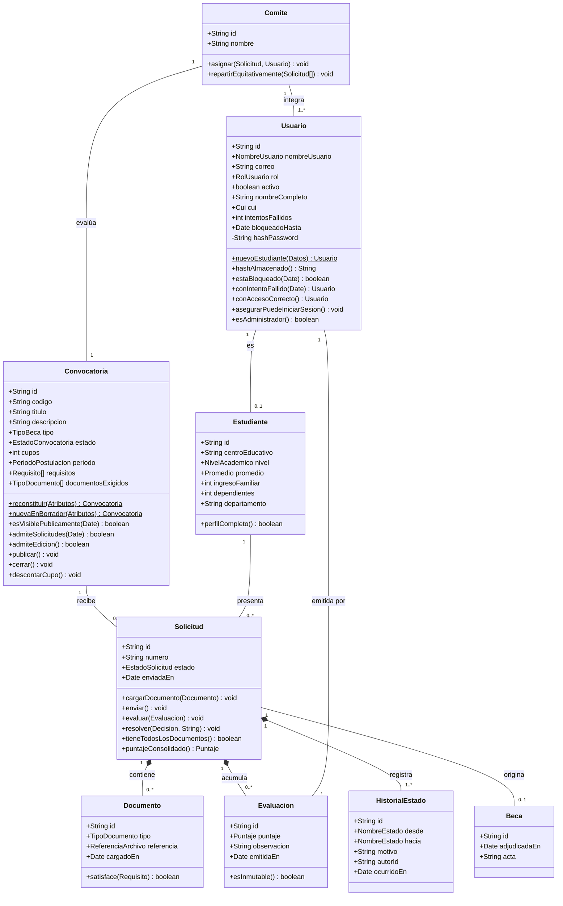
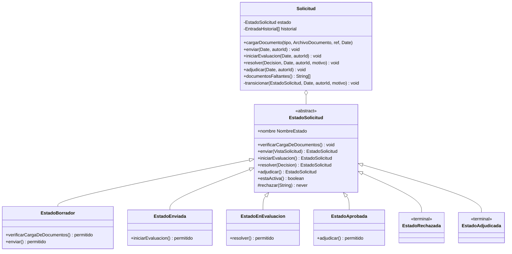
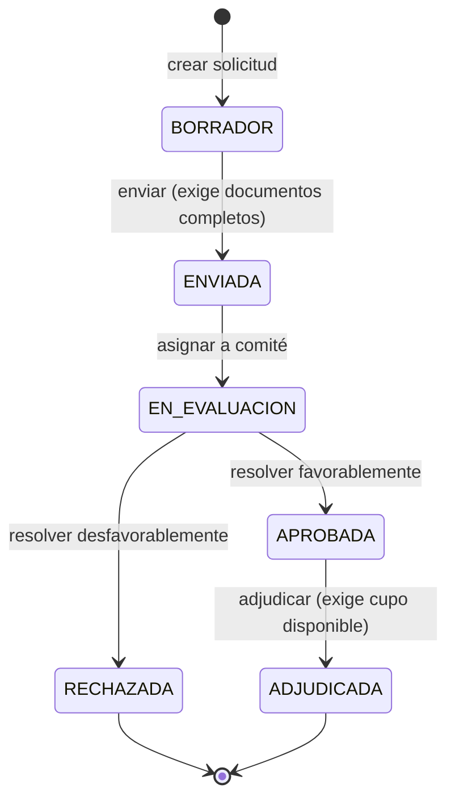
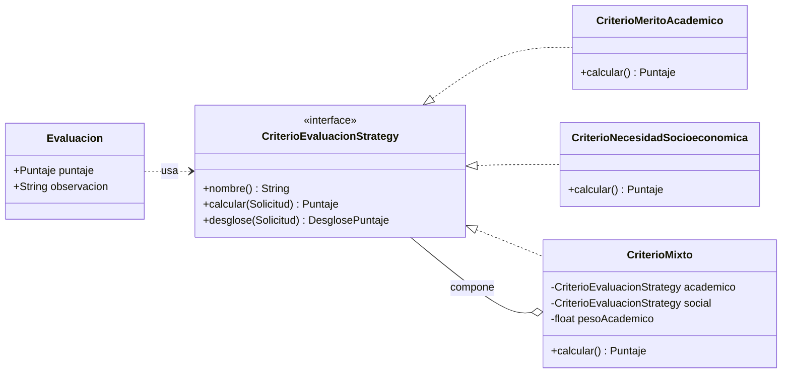

# Diagrama de Clases — Modelo de Dominio
### Anexo 5 §3.3 — Plataforma Nacional para la Gestión Integral de Becas

| | |
|---|---|
| **Responsable** | Fernando (diagramas) · revisado por el equipo |
| **Fecha** | 5 de septiembre de 2026 · **Versión** 1.1 (11 sep: verificado contra el código) |

> Este es el **modelo de dominio**, no el esquema de la base de datos. Se parecen hoy y no tienen
> por qué seguir pareciéndose: la traducción entre ambos es responsabilidad de los *mappers* de
> `infrastructure/`. Ese costo de traducción está aceptado como trade-off en
> `docs/05-arquitectura.md §2.2`.
>
> No se diagraman todas las clases del sistema, solo las **entidades de negocio principales**
> derivadas de los epics y las historias.

---

## 1. Modelo completo

### Cómo leer las relaciones

| Símbolo | Significado | Ejemplo |
|---|---|---|
| `*--` | **Composición.** La parte no existe sin el todo | Un `Documento` no tiene sentido fuera de su `Solicitud`: si se borra la solicitud, se borran sus documentos |
| `--` | **Asociación.** Ambos existen por separado | Una `Convocatoria` existe aunque nadie postule |
| `1..*` | Al menos uno | Toda `Solicitud` tiene al menos un `HistorialEstado`: el de su creación |
| `0..1` | Opcional | No todo `Usuario` es `Estudiante`; un evaluador no lo es |

---

## 2. El patrón State — ciclo de vida de la solicitud

`Solicitud` no guarda su estado como un texto. Lo delega en una jerarquía de clases donde **cada
estado conoce sus propias transiciones legales**.

**La clase base rechaza todo por defecto.** Cada estado concreto solo sobrescribe lo que sí
permite. **Los estados deciden, la solicitud aplica:** cada transición *devuelve* el estado
siguiente, y es `Solicitud.transicionar` quien lo asigna y agrega la entrada al historial. Por eso
el diagrama ya no tiene `cambiarEstado` público (versión 1.2, 16 Sep: ajustado al código). Consecuencia: evaluar un borrador o adjudicar una solicitud rechazada lanza una
excepción sin que ningún otro código tenga que acordarse de comprobarlo.

### Transiciones válidas

Cualquier transición que no aparezca en este diagrama **no existe en el código**: la jerarquía de
estados rechaza por defecto toda operación que no haya sido habilitada de forma explícita.

---

## 3. El patrón Strategy — criterios de evaluación

En la última flecha, `CriterioMixto` **compone** las otras dos estrategias en lugar de
duplicar sus fórmulas. Composición sobre herencia.

Una política de becas nueva es una clase nueva que implementa la interfaz. Cero modificaciones al
código existente: principio Open/Closed.

---

## 4. Objetos de valor

No son entidades: no tienen identidad propia, se definen por su contenido, **se validan al
construirse** y después son inmutables.

| Objeto de valor | Qué encapsula | Estado |
|---|---|---|
| `NombreUsuario` | 3 a 30 caracteres, normalizado a minúsculas | 🟢 Implementado |
| `PeriodoPostulacion` | Que el cierre sea posterior a la apertura | 🟢 Implementado |
| `Cui` | 13 dígitos | 🔴 Sprint 2 |
| `Promedio` | Entre 0 y 100 | 🔴 Sprint 4 |
| `Puntaje` | Entre 0 y 100 | 🔴 Sprint 5 |
| `ReferenciaArchivo` | Identificador opaco del almacenamiento | 🔴 Sprint 4 |

**Por qué no usar un `string` o un `number` suelto:** un `string` puede venir vacío o mal
formado, y cada punto del código tendría que acordarse de validarlo. Al encapsularlo, la regla
vive en un solo lugar y, una vez que existe un `NombreUsuario`, se sabe con certeza que es
válido. Además el compilador impide confundirlo con cualquier otro texto.

---

## 5. Enumeraciones

| Enum | Valores |
|---|---|
| `RolUsuario` | `ESTUDIANTE` · `EVALUADOR` · `ADMINISTRADOR` · `PUBLICO` ¹ |
| `TipoBeca` | `NIVEL_MEDIO` · `UNIVERSITARIA` · `POSGRADO` |
| `EstadoConvocatoria` | `BORRADOR` · `PUBLICADA` · `CERRADA` |
| `NombreEstado` | `BORRADOR` · `ENVIADA` · `EN_EVALUACION` · `APROBADA` · `RECHAZADA` · `ADJUDICADA` |
| `Decision` | `APROBAR` · `RECHAZAR` |

> ¹ **`PUBLICO` no existe en el `schema.prisma`, y es deliberado.** Representa al visitante sin
> sesión: no hay filas de `Usuario` con ese rol y no debe poder haberlas. Es la única diferencia
> intencional entre los dos enums.
>
> **El dominio declara sus propios enums** en lugar de importar los de Prisma, porque importarlos
> metería el ORM dentro de `domain/` y rompería la regla de capas. El precio es mantener dos
> listas sincronizadas; se mitiga con `usuario-prisma.mapper.spec.ts`, que compara los roles
> **persistibles** contra los de Prisma, exige que `PUBLICO` siga fuera, y falla en CI si
> aparece un rol nuevo sin que alguien decida si se persiste o no.

---

## 6. Estado de implementación

> **Cómo leer esta tabla.** El diagrama de arriba es el **modelo de dominio objetivo**, no una
> fotografía del código de hoy. Esta sección dice qué parte ya existe, para que nadie tenga que
> adivinarlo comparando a mano. Verificado contra el código por Fernando en la revisión del
> Sprint 1.

| Clase | Módulo | Estado |
|---|---|---|
| `Usuario` | usuarios | 🟢 Implementada y probada — el diagrama coincide miembro por miembro. Ver la nota ³ |
| `Convocatoria` | convocatorias | 🟡 Implementada salvo cerrar y descontar cupo — ver la nota ² |
| `Estudiante` | estudiantes | 🟢 Implementada y probada (16 Sep). El departamento es un catálogo de 22 valores, no texto |
| `Solicitud` + jerarquía de estados | solicitudes | 🟢 Implementada y probada (16 Sep) — ver §2 |
| `Documento` | solicitudes | 🟢 Implementado como `DocumentoCargado` dentro de `Solicitud` (composición), con `ArchivoDocumento` como objeto de valor |
| `Evaluacion` + estrategias | evaluaciones | 🟢 Implementada como `Dictamen` (16 Sep): inmutable, con el desglose del criterio. Estrategias en §3 |
| `Comite` | evaluaciones | 🟢 Implementado (16 Sep) con el reparto equitativo. Las asignaciones son `Asignacion` |
| `Beca` | solicitudes | 🟢 Implementada (16 Sep) como `BecaOtorgada` dentro de `Solicitud` (composición 0..1): se guarda en la misma transacción que la adjudicación. Tiene código y fecha; el acta es US-026 |
| `HistorialEstado` | solicitudes | 🟢 Implementado como `EntradaHistorial` (16 Sep): solo crece |

### ² Nota sobre `Convocatoria`

Sus atributos y sus dos consultas de negocio existen y están probados. Lo que el diagrama dibuja
y **el código todavía no tiene** son los tres métodos que mutan el estado:

| Miembro del diagrama | En el código | Cuándo |
|---|---|---|
| `reconstituir(Atributos)$` | ✅ Existe (fábrica estática) | Sprint 1 |
| `esVisiblePublicamente(Date)` | ✅ Existe y probado | Sprint 1 |
| `admiteSolicitudes(Date)` | ✅ Existe y probado | Sprint 1 |
| `nuevaEnBorrador(Atributos)$` | ✅ Existe — la llama `ConvocatoriaFactory` | Sprint 3 · US-006 |
| `requisitos`, `documentosExigidos` | ✅ Existen y se persisten | Sprint 3 · US-006 |
| `admiteEdicion()` | ✅ Existe y probado | Sprint 3 · US-007 |
| `publicar()` | ✅ Existe y probado | Sprint 3 · US-007 |
| `cerrar()` | ❌ No existe | Sprint 3 · US-009 |
| `descontarCupo()` | ❌ No existe | Sprint 6 · US-024 |

> La versión 1.0 de este diagrama declaraba un método `estaVigente(Date)` que **nunca existió**.
> En el código esa idea quedó separada en dos consultas distintas a propósito —una convocatoria
> puede ser visible al público y ya no admitir solicitudes— y el diagrama no lo reflejaba. La
> confusión de un solo método que responde dos preguntas es justo el tipo de cosa que un diagrama
> desalineado esconde, y es la razón por la que se verifica contra el código y no al revés.

### ³ Nota sobre `Usuario` y `Estudiante` — cambio del 16 de septiembre

La versión 1.0 ponía el **CUI en `Estudiante`**. Al implementar el registro (US-001) se movió a
**`Usuario`**, junto con el nombre completo:

- **US-001 pertenece al EPIC-01** —gestión de cuentas— y su criterio exige que el CUI sea único
  *para crear la cuenta*. Sin cuenta todavía no existe perfil académico.
- **El CUI identifica a la persona, no a su perfil académico.** Un evaluador también es una
  persona con CUI.
- `Estudiante` queda para los **datos académicos y socioeconómicos** de US-011 —centro
  educativo, nivel, promedio, ingreso familiar—, que se completan después del registro.

En `Usuario` son opcionales porque las cuentas creadas por el Ministerio no pasan por el registro
público. También se agregan al diagrama los miembros del bloqueo por intentos fallidos (US-002),
que ya existían en el código.
